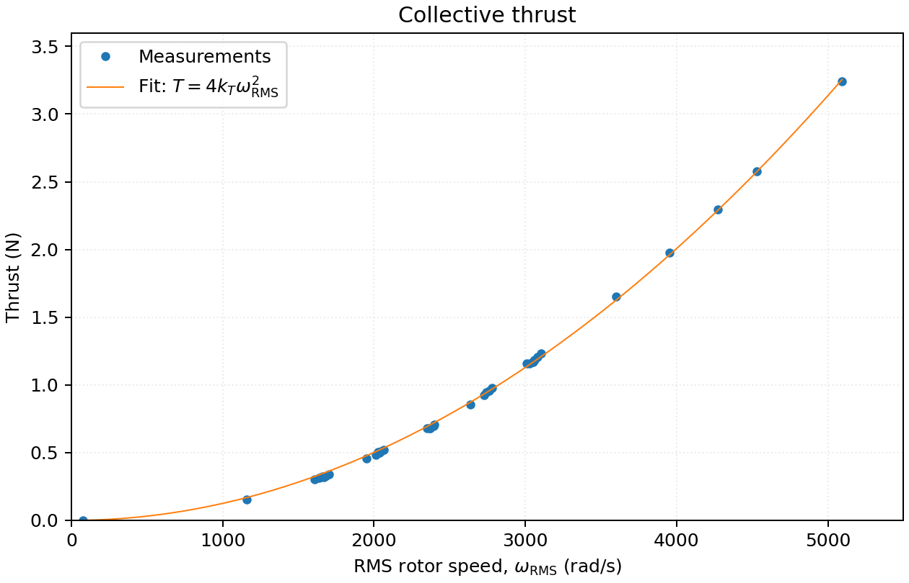
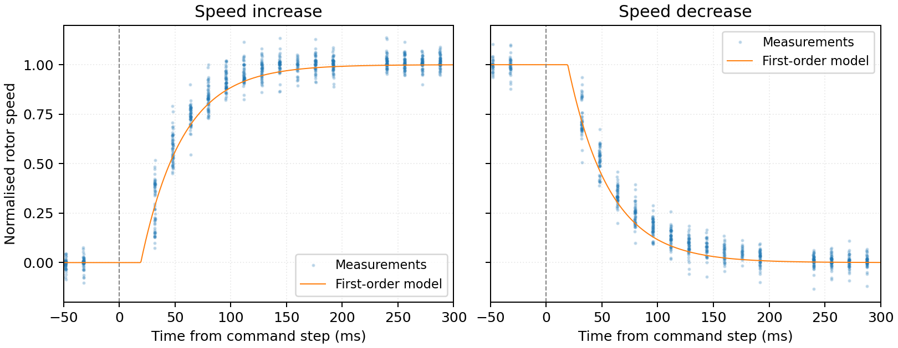

<div align="center">
<h1>Sanity</h1>
<p><strong>An agile brushless quadrotor for multi-agent experiments</strong><br>
Prorok Lab · University of Cambridge</p>
<p><a href="paper/sanity.pdf">Paper</a> · <a href="docs/build-instructions.md">Build guide</a> · <a href="models/sanity.urdf">URDF</a> · <a href="models/sanity.xml">MuJoCo XML</a> · <a href="models/meshes/">Meshes</a> · <a href="parameters/actuators.json">Actuator model</a> · <a href="data/">Data</a></p>

</div>

Sanity quadrotor hardware models, meshes, measured actuator dynamics and calibration data from Prorok Lab, University of Cambridge.

| Multi-agent flight | LED flight |
|:---:|:---:|
| [](media/swarm.mp4) | [](media/led.mp4) |
| 15 aircraft · 4× playback | Eight aircraft with LEDs |

*Click a preview to watch the full video.*

## Files

| File or directory | Contents |
|---|---|
| [docs/build-instructions.md](docs/build-instructions.md) | Assembly instructions with photos |
| [models/sanity.urdf](models/sanity.urdf) | Robot description in URDF (XML), including mass, CoM and inertia |
| [models/sanity.xml](models/sanity.xml) | MuJoCo MJCF with a free base, rotor thrust and reaction-torque inputs |
| [models/meshes/](models/meshes/) | Visual OBJ/MTL meshes and lightweight collision geometry |
| [models/sources/](models/sources/) | STEP, USDZ, DAE and Blender CAD files |
| [parameters/actuators.json](parameters/actuators.json) | Thrust coefficient, response times, command-to-speed coefficients and operating ranges |
| [sanity_isaac.py](sanity_isaac.py) | Batched PyTorch actuator and body-force adapter for Isaac Sim / Isaac Lab |
| [data/](data/README.md) | Raw measurements, processed CSV and experiment index |
| [tools/](tools/) | Conversion, fitting, validation and data-collection scripts |
| [paper/sanity.pdf](paper/sanity.pdf) | Platform paper |

## Robot description

Load `models/sanity.urdf` with a floating base, keeping the `meshes/` directory beside it. Units are metres and radians; the model defines **X forward, Y left, Z up**. The model has one rigid assembly and four fixed rotor frames. Visual materials are included; no textures are required.

The URDF includes the confirmed battery-installed mass of **66.09 g**, CoM at **[0, 0, 0] m**, and bifilar inertia estimate **diag(5.75, 6.64, 9.31) × 10⁻⁵ kg·m²**. All mass and inertia are on `base_link`; the rotor frames are massless.

The MuJoCo XML is generated from the URDF and uses the same meshes and physical parameters. Open it with `python -m mujoco.viewer --mjcf=models/sanity.xml`. Its inputs are rotor thrusts in N and separate signed reaction torques in N·m. See the [MuJoCo notes](docs/technical-notes.md#mujoco-xml) for input ordering and actuator-model integration.

## Actuator model

The measured thrust model is

$$
T_i = k_T\omega_i^2,\qquad k_T = 3.13594\times10^{-8}\ \mathrm{N}/(\mathrm{rad/s})^2.
$$



The collective curve uses $\omega_{\mathrm{RMS}}=\sqrt{\frac{1}{4}\sum_i\omega_i^2}$, so $T_{\mathrm{total}}=4k_T\omega_{\mathrm{RMS}}^2$. Individual-motor measurements are also included in the dataset and fit.

| Parameter | Value |
|---|---:|
| Static fit RMS error, all 51 observations | 0.01754 N |
| Spinning response time constant | 37.41 ms |
| Apparent command-to-RPM delay | 19.29 ms |
| Command-map range | 1250–1450 MSP counts, 7.513–8.112 V |



Measured speed steps, normalised between their settled low and high speeds. The curves show the fitted delay and first-order response.

The delay includes USB and telemetry effects. Angular speed uses the flight controller's configured 12 motor poles. High-speed static measurements include low-battery readings and do not establish a safe thrust limit.

```python
from sanity_actuator import SanityModel, SpinningModel

model = SanityModel()
omega = model.steady_omega([1350] * 4, voltage_V=7.8)
thrust_N = model.thrusts(omega)

rotors = SpinningModel(model, [1350] * 4, voltage_V=7.8)
omega_next = rotors.step(0.01, [1400] * 4, voltage_V=7.8)
```

Outputs follow flight-controller order **M1–M4**. The flight interface accepts roll, pitch, yaw rate and collective thrust through ROS 2 → UDP → ESP32/SBUS → Betaflight. A policy trained on individual rotor commands needs a controller adapter. Equations, hardware details and validation results are in the [technical notes](docs/technical-notes.md).

For Isaac Sim, [sanity_isaac.py](sanity_isaac.py) runs the measured model on CPU or GPU and supplies body forces and moments through Isaac Lab's external-wrench API. It supports batched environments, partial resets and a configurable command delay. Native import, rendering and dynamics checks pass in Isaac Sim 5.1.0 / Isaac Lab 2.3.2. See the [integration example and test results](docs/technical-notes.md#isaac-sim).

The bench data do not identify the hardware-to-frame mapping, rotor rotation directions, physical pole count, yaw reaction torque or usable actuator limits. These parameters are explicitly unknown in [actuators.json](parameters/actuators.json). Native checks validate the simulator implementation; flight deployment has not been validated.

## Reproduce

Tested with Python 3.13.5 and Node.js 22.19.0. Install the Python dependencies in a virtual environment; repository validation also requires FFmpeg.

```sh
python3 -m venv .venv
. .venv/bin/activate
pip install -r requirements.txt

node tools/build_geometry.mjs
python tools/build_mjcf.py
python tools/reduce_loadcell.py
python tools/fit_actuators.py --bootstrap 100
python tools/verify_refit.py
cp build/actuator_fit/multilevel_validation.png media/heldout-validation.png
python tools/plot_actuators.py
python tools/validate_models.py
python tools/validate_mjcf.py
python tools/validate_repo.py
```

Fits and validation reports are written to `build/`. See the [data guide](data/README.md) for the experiments and the [technical notes](docs/technical-notes.md#validation) for validation results.

## Paper and licensing

Heedo Woo, Kazi R. I. Sanim, Keisuke Okumura, Guang Yang, Ajay Shankar and Amanda Prorok. **Sanity: An Agile Brushless Quadrotor for Multi-Agent Experiments.** [PDF](paper/sanity.pdf) · [Citation](CITATION.cff) · [OpenReview](https://openreview.net/pdf/8e2e978377d2793388c80d477162585c60668728.pdf).

Lab-authored CAD, meshes, measurements and documentation are licensed under **CC BY 4.0**; robot descriptions and code use **MIT**. See [LICENSES.md](LICENSES.md) for scope, attribution and third-party notices.

The Sanity CAD models were created from scratch in Autodesk Fusion 360 using physical measurements of a BETAFPV Pavo Pico. No manufacturer CAD files were used. These files provide a geometric representation for robotics simulation; they are not official BETAFPV design files.

## Citation

If you use Sanity in your research, please cite our [paper](https://openreview.net/forum?id=i5dKOANPZZ):

```bibtex
@misc{woo2025sanity,
  title        = {{Sanity}: An Agile Brushless Quadrotor for Multi-Agent Experiments},
  author       = {Woo, Heedo and Sanim, Kazi R. I. and Okumura, Keisuke and
                  Yang, Guang and Shankar, Ajay and Prorok, Amanda},
  year         = {2025},
  howpublished = {OpenReview},
  url          = {https://openreview.net/forum?id=i5dKOANPZZ}
}
```
