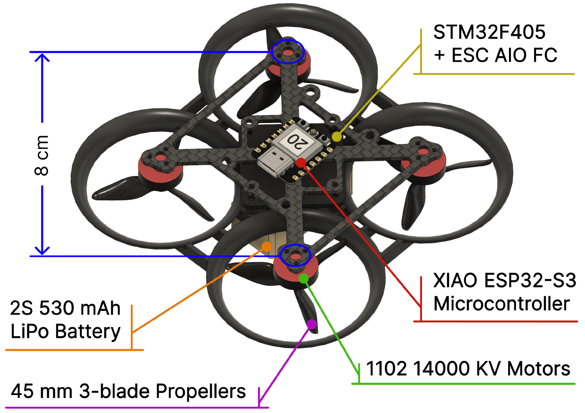
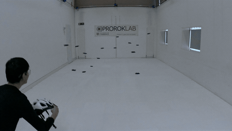
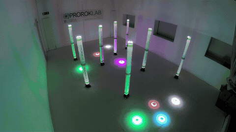

<div align="center">
<h1>Sanity</h1>
<p><strong>An agile brushless quadrotor for multi-agent experiments</strong><br>
Prorok Lab · University of Cambridge</p>
<p><a href="paper/sanity.pdf">Paper</a> · <a href="docs/build-instructions.md">Build guide</a> · <a href="models/sanity.urdf">URDF</a> · <a href="models/sanity.xml">MuJoCo XML</a> · <a href="models/meshes/">Meshes</a> · <a href="parameters/actuators.json">Actuator model</a> · <a href="data/">Data</a> · <a href="docs/inertia.md">Inertia measurements</a></p>

</div>

Sanity quadrotor hardware models, meshes, measured actuator dynamics and calibration data from Prorok Lab, University of Cambridge.

| Multi-agent flight | LED flight |
|:---:|:---:|
| [](media/swarm.mp4) | [](media/led.mp4) |
| 15 aircraft · 4× playback | Eight aircraft with LEDs |

*Click a preview to watch the full video.*

## Files

| File or directory | Contents |
|---|---|
| [docs/build-instructions.md](docs/build-instructions.md) | Assembly instructions with photos |
| [docs/inertia.md](docs/inertia.md) | Bifilar setup, measured results, fixture correction and reproduction |
| [docs/actuator-modelling.md](docs/actuator-modelling.md) | Selected identified models, input conventions and validation |
| [models/sanity.urdf](models/sanity.urdf) | Robot description in URDF (XML), including mass, CoM and inertia |
| [models/sanity.xml](models/sanity.xml) | MuJoCo MJCF with a free base, rotor thrust and reaction-torque inputs |
| [models/meshes/](models/meshes/) | Visual OBJ/MTL meshes and lightweight collision geometry |
| [models/sources/](models/sources/) | STEP, USDZ, DAE and Blender CAD files |
| [media/identification/](media/identification/) | Three selected vector figures: direct thrust, Acro collective/response and provisional yaw torque |
| [parameters/identified_actuators.json](parameters/identified_actuators.json) | Selected 20 October direct-motor, CTBR, response and provisional yaw models |
| [parameters/actuators.json](parameters/actuators.json) | Original 13 October calibration used by the existing actuator API |
| [sanity_isaac.py](sanity_isaac.py) | Batched PyTorch actuator and body-force adapter for Isaac Sim / Isaac Lab |
| [data/](data/README.md) | Raw measurements, processed CSV and experiment index |
| [tools/](tools/) | Conversion, fitting, validation and data-collection scripts |
| [paper/sanity.pdf](paper/sanity.pdf) | Platform paper |

## Robot description

Load `models/sanity.urdf` with a floating base, keeping the `meshes/` directory beside it. Units are metres and radians; the model defines **X forward, Y left, Z up**. The model has one rigid assembly and four fixed rotor frames. Visual materials are included; no textures are required.

The URDF uses the measured battery-installed mass of **69.47 g** and the 19 October 2026 bifilar working estimate **diag(3.32, 4.28, 5.43) × 10⁻⁵ kg·m²** about **[0, 0, 0] m**, the assumed drone CoM. The inertia includes provisional fixture/marker subtraction and parallel-axis corrections; the physical CoM and fixture mass split are not independently calibrated. Off-diagonal terms remain zero as a modelling assumption. See the [inertial update](docs/inertia.md). All mass and inertia are on `base_link`; the rotor frames are massless.

The MuJoCo XML is generated from the URDF and uses the same meshes and physical parameters. Open it with `python -m mujoco.viewer --mjcf=models/sanity.xml`. Its inputs are rotor thrusts in N and separate signed reaction torques in N·m. See the [MuJoCo notes](docs/technical-notes.md#mujoco-xml) for input ordering and actuator-model integration.

## Actuator model

The [selected model guide](docs/actuator-modelling.md) explains the compact [identified parameter file](parameters/identified_actuators.json):

| Selected model | Meaning |
|---|---|
| Direct motor thrust | One shared `T(direct MSP count, delivered FC voltage)` polynomial for all four motors; 393 steady plateaus; **0.0361 N** held-out-command RMS per rotor |
| Thrust from measured speed | `T = 3.27592e-8 × omega² N` per rotor, with mechanical omega in rad/s |
| CTBR collective | Aircraft-total RC-throttle response with **Betaflight Acro, voltage compensation 100 and RC smoothing ON**; voltage input is the **PSU source setting** |
| Observed step responses | Separate rising/falling direct-RPM and Acro fits; include measurement-path effects, not motor-only dynamics |
| Yaw reaction torque | Balanced-contrast coefficient, explicitly **provisional** because torque calibration/lever arms are assumed |

Direct motor counts are not RC throttle; delivered FC voltage is not PSU source voltage. The direct model is restricted to its stored joint command/voltage hull. These models do not establish free-flight rate-loop dynamics, startup behaviour or voltage-independent actuator limits.

The existing Python/Isaac API retains the [original 13 October calibration](parameters/actuators.json), with its narrower 1250–1450-count command map. The new models are explicit offline inputs and have not silently changed that API:

```python
import json
from pathlib import Path

models = json.loads(Path("parameters/identified_actuators.json").read_text())["models"]
direct = models["direct_motor_thrust"]
ctbr = models["ctbr_acro100_collective"]
```

For the original `SanityModel`/`SpinningModel` API and [Isaac adapter](sanity_isaac.py), see the [technical notes](docs/technical-notes.md). The measured mass/inertia are already in the robot descriptions. The model guide embeds three selected vector figures. Full campaign dumps, PDFs and generated archives remain local analysis artifacts rather than part of the curated model contribution.

## Reproduce

Tested with Python 3.13.5 and Node.js 22.19.0. Install the Python dependencies in a virtual environment; repository validation also requires FFmpeg.

```sh
python3 -m venv .venv
. .venv/bin/activate
pip install -r requirements.txt

node tools/build_geometry.mjs
python tools/build_mjcf.py
python tools/reduce_loadcell.py
python tools/fit_actuators.py --bootstrap 100
python tools/verify_refit.py
cp build/actuator_fit/multilevel_validation.png media/heldout-validation.png
python tools/plot_actuators.py
python tools/validate_models.py
python tools/validate_mjcf.py
python tools/validate_repo.py
```

Fits and validation reports are written to `build/`. See the [data guide](data/README.md) for the experiments and the [technical notes](docs/technical-notes.md#validation) for validation results.

## Paper and licensing

Heedo Woo, Kazi R. I. Sanim, Keisuke Okumura, Guang Yang, Ajay Shankar and Amanda Prorok. **Sanity: An Agile Brushless Quadrotor for Multi-Agent Experiments.** [PDF](paper/sanity.pdf) · [Citation](CITATION.cff) · [OpenReview](https://openreview.net/pdf/8e2e978377d2793388c80d477162585c60668728.pdf).

Lab-authored CAD, meshes, measurements and documentation are licensed under **CC BY 4.0**; robot descriptions and code use **MIT**. See [LICENSES.md](LICENSES.md) for scope, attribution and third-party notices.

The Sanity CAD models were created from scratch in Autodesk Fusion 360 using physical measurements of a BETAFPV Pavo Pico. No manufacturer CAD files were used. These files provide a geometric representation for robotics simulation; they are not official BETAFPV design files.

## Citation

If you use Sanity in your research, please cite our [paper](https://openreview.net/forum?id=i5dKOANPZZ):

```bibtex
@misc{woo2025sanity,
  title        = {{Sanity}: An Agile Brushless Quadrotor for Multi-Agent Experiments},
  author       = {Woo, Heedo and Sanim, Kazi R. I. and Okumura, Keisuke and
                  Yang, Guang and Shankar, Ajay and Prorok, Amanda},
  year         = {2025},
  howpublished = {OpenReview},
  url          = {https://openreview.net/forum?id=i5dKOANPZZ}
}
```
