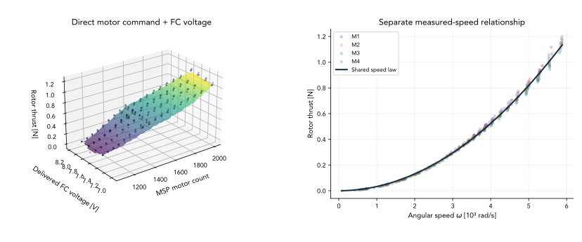
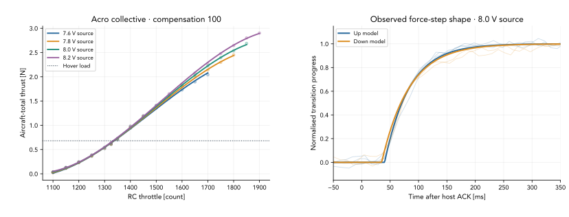
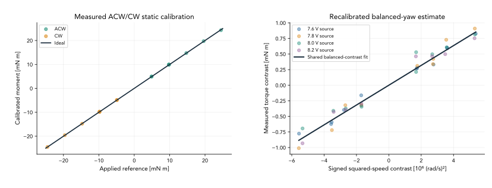

# Actuator modelling

[Compact parameter file](../parameters/identified_actuators.json) · [Measured mass and inertia](inertia.md)

The parameter file retains five useful model groups from the regulated campaign. It contains full-precision coefficients, input definitions, supported domains, validation scores and source hashes. The same per-rotor coefficients apply to every motor. These are explicit offline identification models; the original `SanityModel`/`SpinningModel` API still uses the [13 October calibration](../parameters/actuators.json). Importing the new file requires choosing the appropriate model and respecting its domain.

## Which model to use

| Model key | Input → output | Appropriate use |
|---|---|---|
| `direct_motor_thrust` | Direct MSP motor count + delivered FC voltage → **one rotor's thrust, N** | Shared static motor-level plant |
| `rotor_thrust_from_speed` | Mechanical angular speed, rad/s → **one rotor's thrust, N** | Compact speed-based force law |
| `ctbr_acro100_collective` | RC throttle + **PSU source setting** → **aircraft-total thrust, N** | Descriptive armed Acro bench plant; compose with the deployment newton-to-RC mapping |
| `observed_step_responses` | A command step → normalised observed RPM/force response | Provisional delay/lag sensitivity, with separate rise/fall paths |
| `yaw_reaction_torque` | Angular speed + rotation sign → rotor reaction torque, N m | Shared balanced-contrast estimate with measured static torque calibration |

**Direct motor counts, RC throttle and angular speed are different inputs. Delivered FC voltage and PSU source voltage are different measurements.** A four-motor aircraft need not produce four times the isolated-motor thrust at the same requested command/source voltage.

## Direct motor-command/voltage surface

The primary direct-motor model is

$$
T_{\mathrm{rotor}}(u,V_{FC})=\sum_{i+j\le4}c_{ij}q^i z^j,\qquad
q=(u-1550)/450,\quad z=(V_{FC}-7.5)/0.5.
$$

The same coefficient set is used for each rotor. The JSON lists each coefficient beside its `[q power, z power]`. The model uses **393 steady isolated-motor plateaus**, balanced by motor and command/source-voltage condition. Total degree 4 was selected from degrees 2–4 using held-out command levels.

| Validation | RMS error per rotor |
|---|---:|
| Training | 0.02494 N |
| Held-out command levels | 0.03610 N |
| Held-out source-voltage settings | 0.03489 N |

The bounding ranges are **1100–2000 counts** and **6.964–8.190 V delivered FC voltage**. Predictions are supported **only inside the joint convex hull stored in the JSON**, not throughout that rectangle. Thrust and both input slopes are constrained nonnegative over fitted support. There is no inferred STOP/idle/startup curve. The command is an MSP motor-test count; ESC output was DSHOT300, not a measured PWM pulse width.

The separate compact speed law is **T = 3.2759217253e-8 × omega² N**, with omega in rad/s. Its held-out-command RMS is **0.01861 N**, using the same steady points. This smaller error conditions on measured speed, so it is not an equal-input performance comparison against the command model. The individual speed-law coefficients span −1.69% to +2.79% around the common value.



*Left: the shared direct-command/FC-voltage surface and measured isolated-motor points, restricted to joint measured coverage. Right: the separate thrust–speed law; colours retain individual motor observations.*

To rotate, pan and zoom the fitted surface in an interactive window:

```sh
python tools/view_thrust_surface.py
```

Left-drag rotates, middle-drag pans, and right-drag zooms. For a trackpad, select the toolbar’s Pan tool and left-drag. Press **R** to reset the view. The controls toggle measurement points and surface opacity. The viewer uses the compact parameter file; it automatically overlays the 393 measurements when the local campaign archive is available. Pass `--measurements /path/to/thrust_command_voltage_surface.json` for a different archive location, or `--no-measurements` for the model alone. The plotted force is **per rotor**, with the surface restricted to the measured joint command/voltage hull.

## CTBR through Betaflight

Use the **Acro, voltage compensation 100, RC smoothing ON** collective model for the currently targeted CTBR configuration. It has 84 steady observations and **0.02036 N** held-out-command RMS. Its equation, coefficients and command ranges for each source-voltage setting are in `ctbr_acro100_collective`.

The voltage input is **PSU source setting**, including the bench power path; do not feed it live FC/battery voltage as though they were interchangeable. For deployment-matched simulation, compose the fitted forward response with the same newton-to-RC mapping used on hardware. A battery-bus-dependent Acro model requires further reduction/validation.

The highest observed Acro thrust was **2.902 N at 8.2 V source and RC 1900**. It is not a voltage-independent flight rating or evidence for the old 3.2 N simulation ceiling. The aircraft was rigidly held with zero rate requests: body-rate tracking, rotational bandwidth and nonzero-moment mixer behaviour were not identified.



*Left: measured aircraft-total thrust with compensation 100; faint points are observations and solid curves are the source-voltage bench fits. Right: representative 1200↔1300 RC steps at 8.0 V source. Faint traces are measured; solid rise/fall models are fitted to the other voltage runs. Endpoints are normalised, so this checks response shape rather than absolute gain. These are whole-aircraft Acro tests, unlike the isolated-motor figure above.*

## Response and calibrated yaw-torque estimate

The response candidates use a delayed one-pole observation fit, `h(t) = 1 − exp(−max(t−L,0)/tau)`, with measured endpoints. The displayed 8.0 V condition was held out of timing fitting.

| Path | Rising L / tau | Falling L / tau |
|---|---:|---:|
| Direct RPM, rear-terminal cohort | 6.35 / 26.89 ms | 6.00 / 33.07 ms |
| Acro compensation 100, observed RPM | 24.90 / 42.57 ms | 18.23 / 68.86 ms |
| Acro compensation 100, observed force | 40.25 / 43.88 ms | 35.02 / 48.55 ms |

Time zero is host command acknowledgement. Force includes HX711/fixture response; RPM includes telemetry timing; Acro includes filtering/mixing. These are **not motor-only poles or measured body-rate time constants**. Do not add overlapping delays twice. A one-pole observation fit does not establish the physical system order.

On 21 October, known weights on a reversible **27 g acrylic arm** calibrated both torque channels in ACW and CW directions. With each channel expressed as its change from the matching stopped/bare-arm tare:

$$
\tau_{\mathrm{ACW}}=-1.7417657664\times10^{-6}\Delta c_1
                    -2.0314283065\times10^{-6}\Delta c_2
\quad[\mathrm{N\,m}].
$$

ACW is positive **from the calibration operator’s viewpoint**. The historical report uses $Q_{\rm rig}=-\tau_{\rm ACW}$, preserving its existing plot/rotor sign convention; this has not independently established drone body +Z. The measured gains **replace** the transferred thrust-cell gradient and assumed 30 mm arms. Do not apply an additional lever-arm factor.

| Calibration check | Result |
|---|---:|
| Accepted loaded captures / unsigned mass–distance conditions | 16 / 6, both directions |
| Static reference range / smallest nonzero magnitude | ±24.52 / 4.90 mN m |
| Training RMS | 0.0908 mN m |
| Held-out mass–distance-condition RMS / maximum error | 0.1419 / 0.4485 mN m |

Both signs and all repeats of a held-out mass/distance condition were excluded together. Reference weights and distances were nominal; residuals are not a total uncertainty bound. The orientation-specific tare removes the acrylic arm’s self-moment.

Reprocessing retained **855 historical plateaus**, with **808 paired torque estimates** across the two regulated cohorts and earlier battery campaign. Each channel was recalculated from its saved baseline-subtracted counts before refitting. Missing torque remains missing, original raw samples and old estimates are preserved locally, and thrust/power/response models are unchanged.

The updated common rotor reaction model is

$$
Q_i=s_i\,k_Q\omega_i^2,\qquad
\boxed{k_Q=1.5888988282\times10^{-10}\;\mathrm{N\,m/(rad/s)^2}}.
$$

The balanced-test equation uses $Q=k_Q(\omega_1^2-\omega_2^2-\omega_3^2+\omega_4^2)$ in the historical rig convention. The fit has **38 contrasts** and **0.0952 mN m RMS**. The coefficient is **32.9% higher** than the previous 1.1954420184e-10 estimate; the change is derived from two channel gains, not one global multiplier.

Transfer assumes the same wiring and mechanical reaction path as the drone tests. Balanced-yaw signals are below the smallest nonzero calibration load. Physical spin/body signs, dynamic torque response and free-axis rate dynamics still require separate verification. Individual rig-moment polynomials can include thrust coupling and are not retained as independently calibrated rotor drag models.



*Left: known applied moments versus the shared two-channel calibration, with the ideal line. Right: recalibrated adjacent-neutral yaw contrasts and one shared kQ; faint points retain source-voltage conditions. Static rig calibration does not independently establish per-rotor aerodynamic drag or body-axis sign.*

## Platform context and provenance

The URDF already uses **69.47 g including the 2S 530 mAh pack**, and body-axis inertia **diag(3.32, 4.28, 5.43) × 10⁻⁵ kg m²**, with the documented provisional CoM/fixture corrections. Highest completed direct collective thrust was **2.919 N**, giving a **bench TWR of 4.29**. Efficiency, electrical-loss and battery-sag observations remain in the local analysis; conditional endurance and maximum-speed scenarios are not promoted to identified actuator parameters.

The raw audit reproduced **767 static plateaus and 986 step-signal records**, with **4,617 matching raw-file hashes**. The compact JSON records source-product and torque-calibration SHA-256 hashes, both measured channel gains, and the old/new kQ change. The 21 October update separately checked all 88 battery-campaign plateaus against raw torque counts. Full campaign JSONs, candidate-fit inventories, traces, PDFs and high-resolution/reproduction archives remain local analysis artifacts and are excluded from this curated Git contribution.

To regenerate these three vector figures from the local campaign archives:

```sh
python tools/plot_identified_models.py --fullrange /path/to/sanity_fullrange_id_20261020
```

The matching `sanity_regulated_id_20261020` archive must be beside it (or pass `--regulated`). The larger archives are intentionally external. [Figure provenance](../media/identification/provenance.json) records model, script, source and SVG hashes. SVG curves and text remain sharp when enlarged; no report PDF is included.
