# Building Sanity

This guide covers assembly of the original Pavo Pico-based Sanity platform. For a pre-assembled kit, follow the steps marked **\***. First remove the four M2 screws securing the carbon frame to the duct to access the solder pads underneath the FC+ESC board.

## Parts and tools

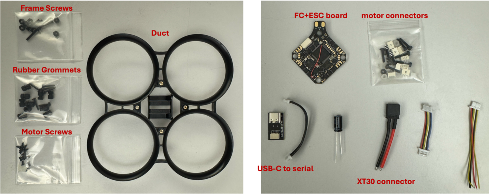

Also required, but not pictured:

- Four BETAFPV 1102 V2 14000KV brushless motors.
- Carbon frame, included in the frame kit.
- Seeed Studio XIAO ESP32S3 microcontroller.
- Five lengths of 28 AWG silicone wire, approximately 10 cm each.

Prices are historical estimates in GBP; check suppliers for current prices and availability.

| Part | Supplier / reference | Estimated price (GBP) |
|---|---|---:|
| 1102 V2 14000KV motors, four | [BETAFPV — select 14000KV-37mm (2022)](https://betafpv.com/products/1102-13500kv-brushless-motors?variant=40143831105670) | 32.95 |
| Pavo Pico frame kit | [Unmanned Tech](https://www.unmannedtechshop.co.uk/products/betafpv-pavo-pico-brushless-whoop-frame) | 6.90 |
| BETAFPV F4 2–3S 20A AIO | [Unmanned Tech](https://www.unmannedtechshop.co.uk/products/betafpv-f4-2-3s-20a-aio-flight-controller) | 44.95 |
| Seeed XIAO ESP32S3 | [Unmanned Tech](https://www.unmannedtechshop.co.uk/products/seeed-xiao-esp32s3) | 6.07 |
| M3 × 6 mm nylon screws | [Unmanned Tech](https://www.unmannedtechshop.co.uk/products/10x-m3-x-6mm-nylon-screw-pack) | 0.45 |
| Silicone wires, 28 AWG | [Unmanned Tech](https://www.unmannedtechshop.co.uk/products/hook-up-silicone-wire-kit) | — |
| Pre-built Pavo Pico kit | [BETAFPV — original Pavo Pico](https://betafpv.com/products/pavo-pico-brushless-whoop-quadcopter) | 84.95 |
| **Total: individual parts** | | **90.87** |
| **Total: pre-built kit + ESP32S3** | | **91.02** |

Use the original Pavo Pico frame and 14000KV motors specified above. Pavo Pico II and LAVA motors are different hardware.

Tools:

- Mini Phillips screwdriver.
- 1.5 mm hex driver for the M2 frame screws.
- Soldering tools.

## 1. Update the software

### Flight controller (Betaflight) \*

Install **Betaflight 4.5.1**, target **BETAFPVF405**, using Betaflight Configurator.

### ESC firmware (Bluejay) \*

Update the ESC firmware to Bluejay.

### ESP32 firmware \*

1. Install the ESP-IDF toolchain using the [ESP32-S3 setup guide](https://docs.espressif.com/projects/esp-idf/en/stable/esp32s3/get-started/index.html). Select the `esp32s3` target; for an ESP-IDF installation using `install.sh`, run `./install.sh esp32s3` from its directory.
2. From the ESP32 firmware project directory, load the toolchain, select the target, build and flash:

```sh
source /path/to/esp-idf/export.sh
idf.py set-target esp32s3
idf.py build
idf.py -p PORT flash monitor
```

Replace `PORT` with the ESP32 serial device. On macOS, list the candidates with `ls /dev/cu.*`, then run, for example:

```sh
idf.py -p /dev/cu.usbmodem101 flash monitor
```

## 2. Prepare the FC+ESC board

### Solder the motor connectors

The kit includes two connector types. Use the **90-degree bent connectors**, with the plastic housings protruding above the board as shown.

<p>
  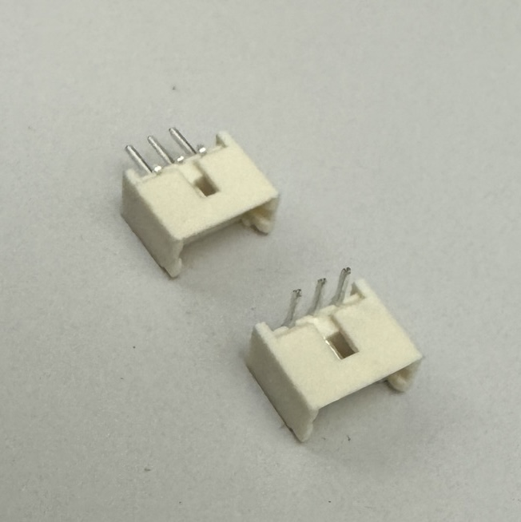
  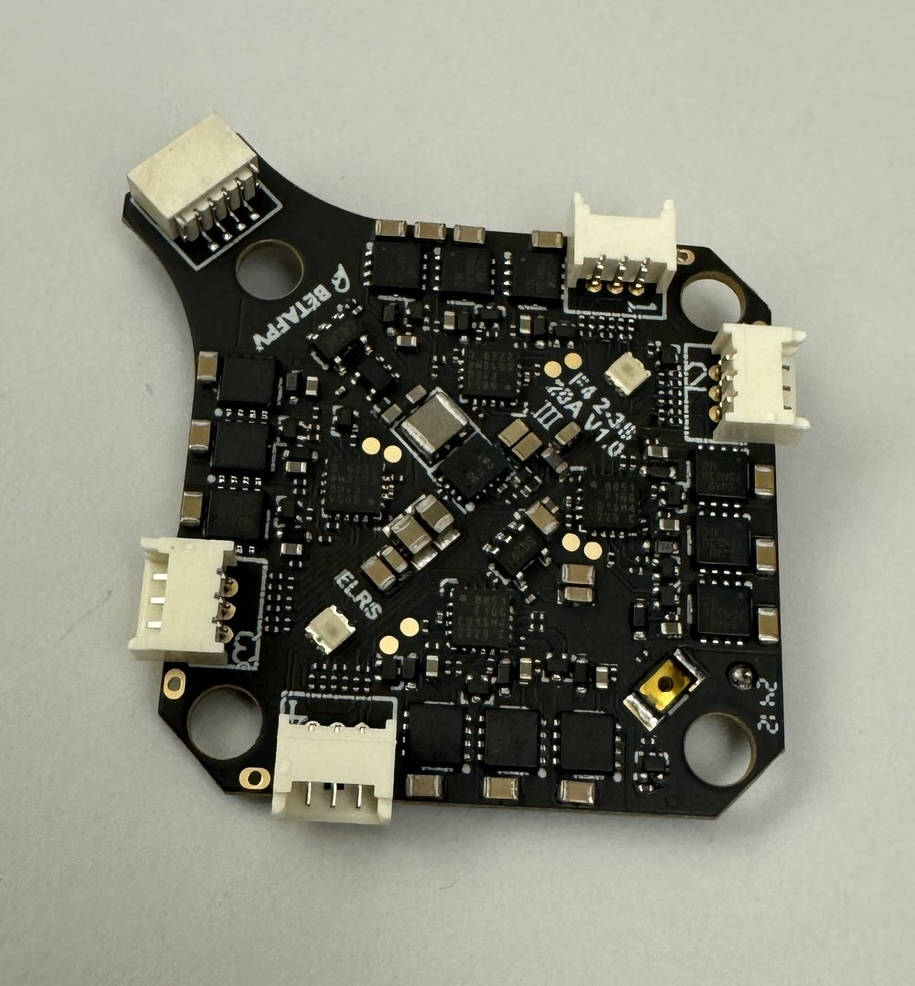
</p>

### Solder the XT30 battery connector

Connect **red to +** and **black to −**.

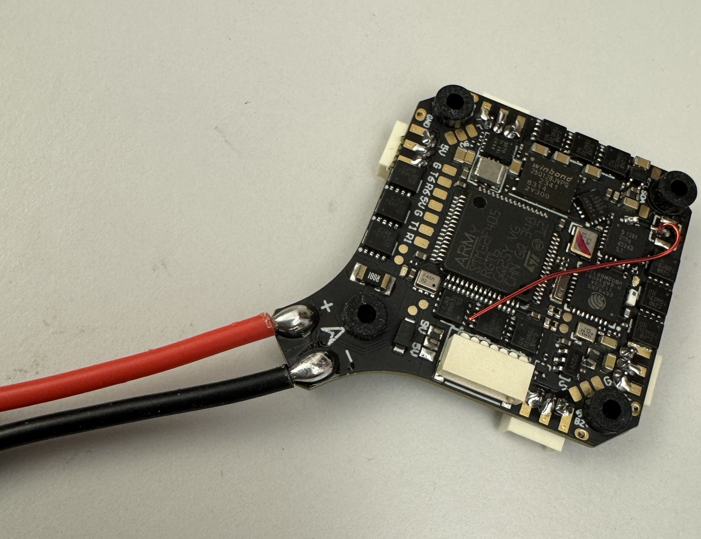

### Insert the rubber grommets

Push the shorter side through each hole in the AIO board. Inserting diagonally makes this easier.

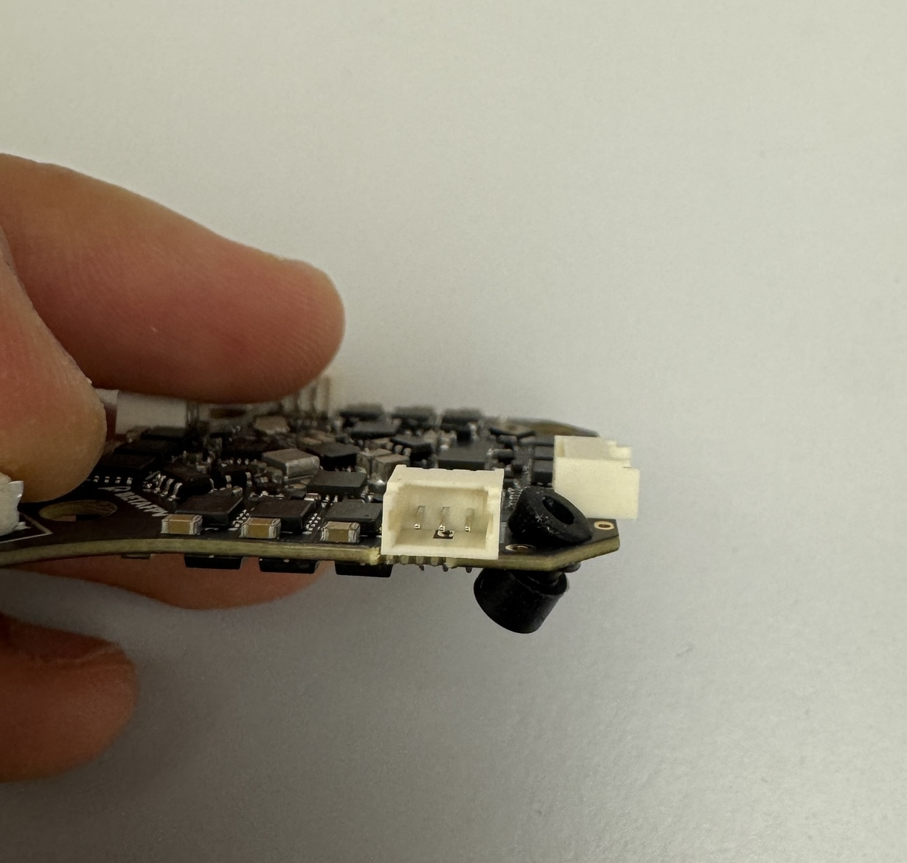

### Solder the SBUS and telemetry wires \*

Connect the SBUS wire to **RX6** on the underside of the board. Connect the red and black wires to **5V** and **GND**, respectively. Follow the board and wiring shown below.

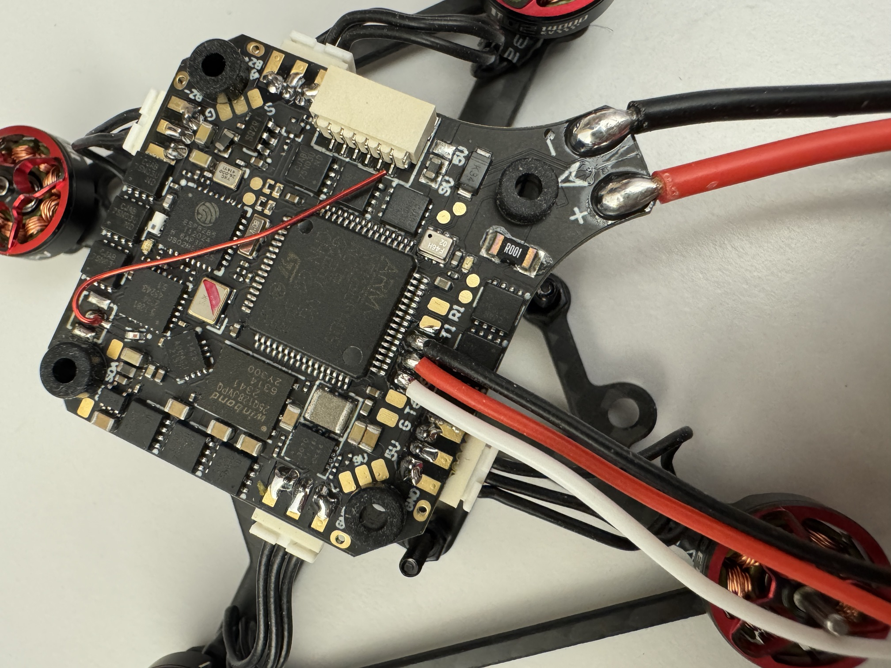

## 3. Prepare the frame

### Attach the motors

Use the **motor screws supplied with the frame kit**. The screws supplied with the motors may be too long and can short the motor coils.

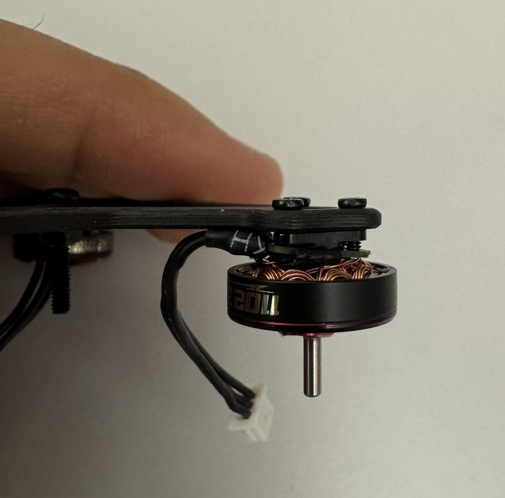

### Attach the FC+ESC board

Insert the frame kit's M2 screws as shown, then loosely tighten the M2 nuts. Route the silicone wires through the frame cutouts **\***.

<p>
  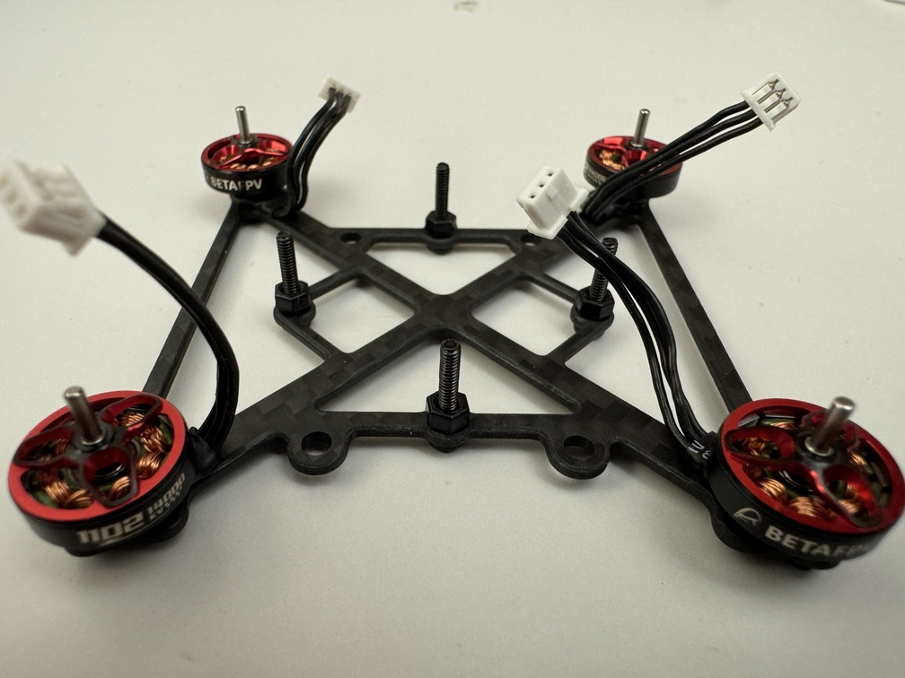
  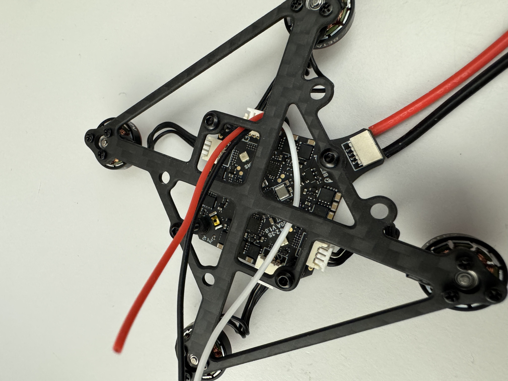
</p>

### Attach the frame to the duct and fit the propellers

Align the four M2 screws with the duct's brass inserts and tighten with the 1.5 mm hex driver. Stop before compressing the rubber grommets.

Press the propellers firmly onto the motor shafts. Match each propeller's handedness to its motor's configured rotation direction.

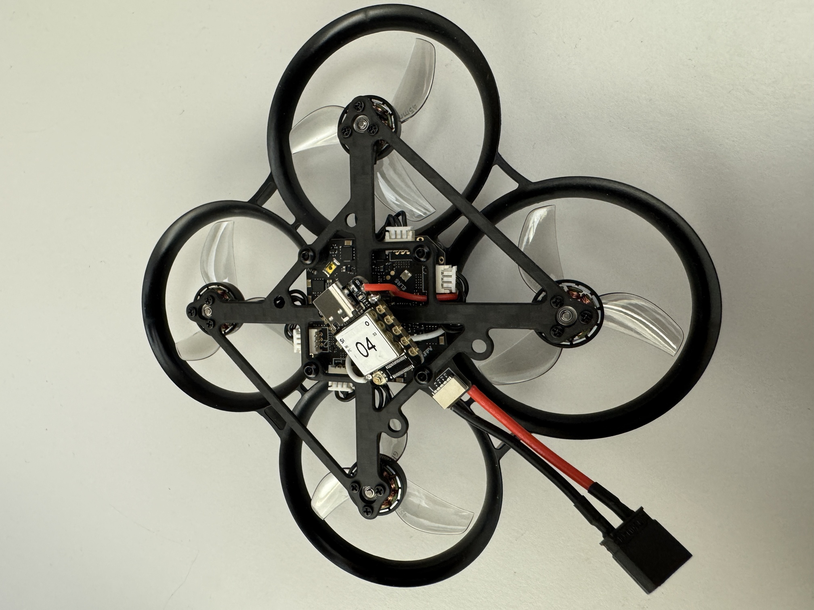

### Clip on the motion-capture frame \*

## 4. Add the ESP32 microcontroller

### Solder the SBUS and telemetry wires \*

Shorten excess wire before soldering. Refer to the [Seeed Studio XIAO ESP32S3 pinout](https://wiki.seeedstudio.com/xiao_esp32s3_getting_started/) and the pin assignments in your firmware. The photo below shows the installation.

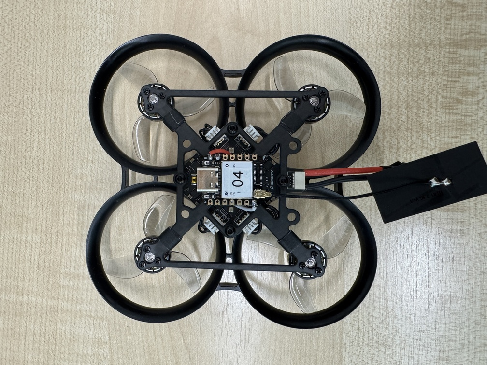

### Attach the microcontroller \*

[Back to the repository](../README.md)
