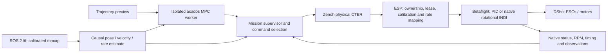

# Controllers and timing

## Signal path

Public commands are `[total_thrust_N, roll_rate, pitch_rate, yaw_rate]`, with rates
in rad/s. World axes are Z up; the host body model is X forward, Y left, Z up.
Quaternion state uses WXYZ and rotates body to world. ROS TF quaternions arrive
XYZW. The transport/native interfaces perform the required FC FRD conversion;
applying another manual pitch/yaw sign change would duplicate that conversion.

The root state is `[p_world(3), q_wxyz(4), v_world(3), omega_world(3)]`. Upright MPC
predicts the root rather than a policy IMU point. Command counts, RC throttle,
newtons, reported RPM and electrical RPM are distinct quantities.

## Upright MPC with PID inner control

`loco_mjx/experiments/sanity_ctbr_sim2sim/mpc_controller.py` implements the acados
controller used by the ordinary trajectory supervisor. The historical predictor
has ten states `[p,q,v]` and ideal body-rate inputs. Its dynamics are

\[
\dot p=v,\quad
\dot q=\tfrac12 q\otimes[0,\omega_b],\quad
\dot v=R(q)e_3 T/m-[0,0,g]-R(q)D R(q)^T v+b.
\]

Drag `D` and horizontal disturbance compensation `b` are optional; the historical
PID recipes use zero drag and no disturbance observer. Internally the upright
solver normalizes collective by mass; its external API and outgoing commands
remain total newtons.

The cost penalizes timed position/velocity error, quaternion attitude error and
thrust/rate departure from acceleration-derived feedforward. The upright
feedforward constructor requires positive upward specific force, so this
controller cannot be made into the flip controller merely by raising a tilt cap.

The baseline uses ten 100 ms intervals: one second of preview at a 50 Hz host
command-selection rate. It uses SQP_RTI, partial-condensing HPIPM and Gauss–Newton.
Raw status, finite values, input bounds, predicted tilt and nonlinear rollout are
checked before acceptance. The high-bank PID recipe uses a 60° MPC tilt constraint,
58° reference-planning limit, 65° fallback and 75° hard tilt bound. These are
separate checks with different meanings.

`experiment.py` / `ros_sequence.py` perform PD takeoff and repositioning, a gated
blend into MPC, trajectory tracking, then PD braking/return/descent and disarm.
The retained metadata sometimes calls the active phase `policy` and uses
`policy_weight`; for an MPC run these mean MPC tracking authority. No actor is
loaded and no learned policy is needed for this branch's recipes.

The ordinary model XML contains 69.47 g total mass. The historical flip model
below uses 69.85 g. Neither is silently replaced by the newer Sanity15 mass.

## MPC with measured-RPM rotational INDI

The modern mission lives in `indi_mpc_benchmark.py`, on top of
`full_indi_mission.py` and `indi_lemniscate.py`. The outer controller still outputs
physical CTBR; the native FC selects PID or INDI only after its actual mode/status
acknowledgement. Requested authority alone does not admit takeoff.

The updated Sanity15 predictor uses 71.51 g and sixteen states: `[p,q,v]` plus six
causal rate-response states. Roll/pitch use fitted second-order responses with a
zero, fitted on 0.5–3 Hz and checked on held-out 4 Hz. Yaw's 0.125 s time constant
is an engineering assumption. The effective thrust multiplier 0.953 and body
velocity damping `[0.587,0.820,0]/s` are fits to partial flights, not independent
thrust or aerodynamic calibrations.

The INDI MPC uses twenty 50 ms intervals, internal integration steps no longer
than 10 ms and angular-acceleration regularization `[0.002,0.002,0.001]`. It retains
the 25 ms computation budget and checks candidate feasibility. The current code
can perform bounded additional feasibility iterations for the identified model;
all attempts and resulting defects/violations are logged.

The native FC's rotational INDI uses local gyro/RPM, a matched observation filter,
rate-error acceleration demand and incremental bounded allocation. Its configured
rate gains are `[20,20,8]/s`, matched filter 12 Hz, rate-reference feedforward
`[0.25,0.25,0]` and derivative cutoff 20 Hz, with 20 rad/s² feedforward caps. The
1 kHz FC loop is separate from the 50 Hz host MPC. Model and telemetry faults
remain native FC decisions. See the included current source patch rather than
assuming stock Betaflight PID protections execute identically under INDI.

The normal healthy modern sequence is ground warmup → actual selected-inner
acknowledgement → takeoff → transfer/settled entry → MPC blend → three laps →
return/hold/landing. INDI can use the bounded 1.2-weight launch floor for at most
0.5 s after acknowledgement; PID comparison disables it. Native faults may
request bounded emergency PID landing. This is not a planned healthy-flight
handover, and it does not establish inverted recovery capability.

PID and INDI comparison recipes use the same Sanity15 mass/geometry, but their
outer predictors and takeoff recipes differ: PID retains ideal-rate prediction;
INDI uses the fitted predictor, drag/effectiveness and regularization. Comparing
their flights tests complete controller combinations, not only the inner loop.

## Reference parameterization

The three lemniscate schedules remain selectable in the underlying builder:

| Schedule | Meaning |
|---|---|
| `constant_arclength` | Approximately constant tangential cruise speed using numerical arc length |
| `variable_angular` | Gerono geometry with the original angular phase ramps |
| `indi_shaped_angular` | Same Gerono geometry and requested peak, with bounded analytic acceleration/jerk ramps and C3 septic transfers |

The Gerono curve is `x=R sin(theta)`, `y=(R/2) sin(2 theta)`: R3.2 occupies a
6.4 × 3.2 m reference footprint, while R2 occupies 4 × 2 m. Current native recipes
are centered at world XY `[0,0]`, not the takeoff point. Historical PID trajectory
coordinates are translated by the captured takeoff origin.

At 1.5 m/s R3.2, shaping lengthens the requested 2 s ramp to about 4.251 s while
preserving geometry, peak and three laps. The separate high-speed recipes raise
the explicit reference acceleration/jerk bounds to preserve their actual requested
3/4/5/6 m/s peaks and two-second ramps. Do not describe those high-speed bounds as
the low-speed 1.5 m/s² / 2 m/s³ shaping limit.

## Full-attitude PID-inner pitch loops

`sanity_pitch_mpc/controller.py` and `pitch_mission.py` implement the separate
full-attitude controller. The selected fitted-rate mode has 22 internal states;
the legacy external measured input is 14 states, including collective. It retains
collective rise/fall lag, fitted small-rate roll/pitch dynamics and delay stages,
a causal angular-rate observer, physical torque/allocation headroom and yaw
assumptions. Default prediction is twenty 40 ms intervals with two RTI iterations.

The successful run-in reference is level acceleration to 2.4 m/s, a C4 pitch
entry, an elliptical pitch loop, C4 exit, braking and upright recovery. One loop
uses about 0.885 s. Reference tracked-point bounds relative to launch are
X ±1.779 m and world Z about 0.475–1.740 m for the 0.5 m bottom setting. Add
physical aircraft size, tracking error and recovery/landing space to those bounds.
The command caps are 2.85 N, roll ±2.3, pitch ±9.5 and yaw ±2.6 rad/s. The stock
upright tilt guard is not applied during intentional inversion.

The historical pitch path uses SZC3, a linear 600°/s rate map and PID inner
control. A first Ctrl+C requests completion of the already planned loop sequence
and upright landing; it is not an immediate cancellation of all remaining loops.
A second interrupt or SIGTERM requests immediate disable. Upright PD is not an
inverted recovery controller. The prepared November INDI flip extension uses a
different SZC6/authority path and is not the physically demonstrated flip recipe
in this branch.

## Timing, worker state and limits

MPC runs in a child process, never in the ROS command callback. Observations and
selected-command commits use ordered IPC. Prediction and observers consume the
actual selected outgoing commands, including blends/fallback, rather than rejected
solver candidates. Models and native libraries are hash-keyed in the solver cache;
compilation/warmup occurs before enabling flight.

The ordinary computation deadline is 25 ms and the source-state freshness rule is
40 ms. The modern rate-model path projects state to the expected application epoch
using 20 ms asynchronous selection plus nominal 15 ms command staging and selected
history. The 15 ms term is an engineering approximation, not a measured universal
one-way delay. Projection does not grant stale-state permission. Command leases,
receiver ownership, FC status and voltage/calibration checks remain independent.

Solver time, Python preparation/transfer/validation time, source-state age and
end-to-end actuator latency are different measurements. A 1–6 ms solver result is
not evidence of an equally short complete mocap-to-motor delay.
