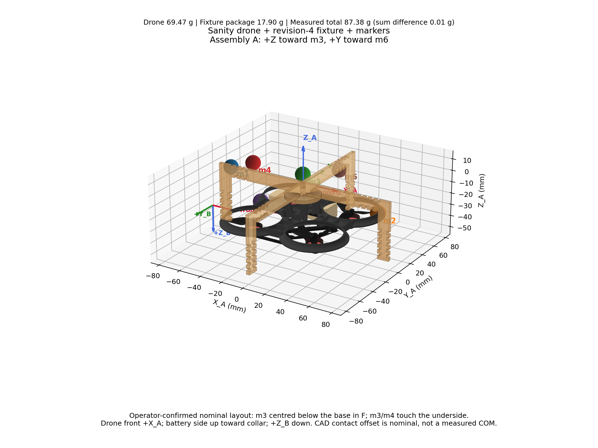
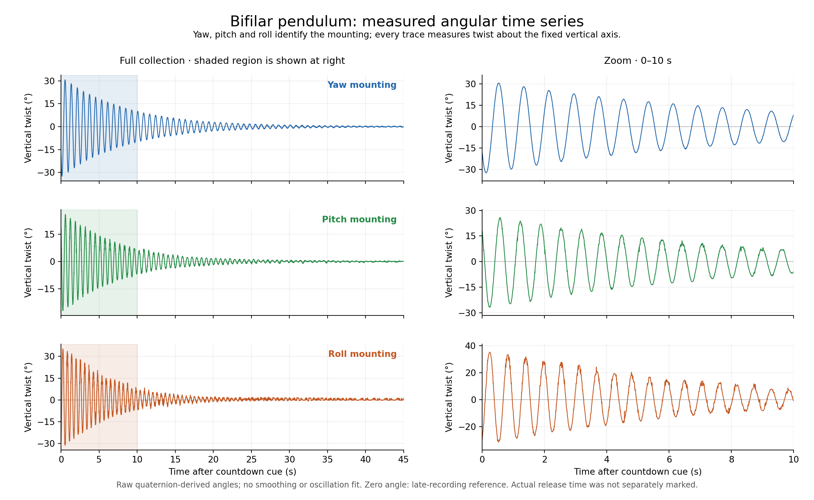

# Drone inertia from the bifilar measurements

The 19 October 2026 measurements give the working model below. The drone mass is **69.47 g**. Inertia is expressed about the **assumed drone centre of mass**, with **X forward, Y left, Z up**.

| Body axis | Previous URDF (kg·m²) | Current URDF (kg·m²) | Change |
|---|---:|---:|---:|
| Roll / X | 5.75 × 10⁻⁵ | **3.32 × 10⁻⁵** | −42% |
| Pitch / Y | 6.64 × 10⁻⁵ | **4.28 × 10⁻⁵** | −36% |
| Yaw / Z | 9.31 × 10⁻⁵ | **5.43 × 10⁻⁵** | −42% |

[The URDF](../models/sanity.urdf) and its [generated MuJoCo model](../models/sanity.xml) use these values, rounded to three significant figures. CoM remains `[0,0,0]`; cross terms remain zero as modelling assumptions. The previous mass was 66.09 g. These changes do not update trained policies or their frozen simulation assets.

## Setup and measurements



The drone is centred against the circular collar, battery side toward it. Its front follows assembly +X and its +Z points downward. The fixture has two perpendicular 3 mm plywood U profiles, each 160 mm wide × 50 mm high, and a 30 mm collar. The [revision-4 DXF](../data/raw/bifilar/20261019/u_mount_rev4.dxf) contains the exact nominal outlines.

| Weighing | Mass |
|---|---:|
| Entire suspended assembly | 87.38 g |
| Drone, including battery | 69.47 g |
| Fixture, all six markers and tape/glue/mounts | 17.90 g |
| Each 12.7 mm marker | Approximately 1.08 g |
| Six markers | Approximately 6.48 g |
| Non-marker fixture remainder | Approximately 11.42 g |

The separate masses sum to 87.37 g, **0.01 g below** the combined weighing. The 11.42 g remainder is not a separately measured plywood-only mass.

Two strings were used. Spacings below are **full contact-to-contact distances**; the reported 64.2 cm length supersedes the earlier 64.5 cm value.

| Collection order | String length | Upper spacing | Lower spacing | Drone axis vertical |
|---|---:|---:|---:|---|
| 1. Yaw | 64.2 cm | 15.6 cm | 13.2 cm | −Z |
| 2. Pitch | 64.2 cm | 15.6 cm | 15.5 cm | −Y |
| 3. Roll | 64.2 cm | 15.6 cm | 15.5 cm | −X |

From yaw, the operator rotated +90° about assembly +X for pitch, then −90° about the assembly's **own +Z** for roll. The [three mounting views](../media/inertia/mountings.png) show this sequence. Axis sign does not change scalar inertia.

Assembly A has +X from m4 toward m3, +Y toward m6 and +Z toward top marker m3. Geometric fixture F has the opposite Y/Z directions; its +Z points toward the open arms. Their origins differ. M3/m4 touch the bottom plywood face directly. The recorded Motive pivot shift is already in `/tf`; it must not be applied again. Neither the tracking pivot nor the CAD origin is a separately measured physical CoM.

## From oscillations to drone-only inertia



The plots show twist about recorded `map` +Z, with angle referenced to the final 10 seconds. Time zero is the countdown cue, not a separately recorded release. Each trial contains approximately 45 seconds after the cue at 200 Hz, plus the 10-second approach interval.

A common **10–20 s** interval avoids the initial large-angle motion. Source timestamps are used for fitting. The model is offset + linear drift + an exponentially decaying sinusoid:

$$
\theta(t)=c_0+c_1t+e^{-\lambda t}[A\cos(\omega_dt)+B\sin(\omega_dt)].
$$

With total suspended mass $M$, string length $L$, and half-spacings $a,b$:

$$
h=\sqrt{L^2-(a-b)^2},\qquad
I_{\rm assembly}=\frac{Mgab}{h(\omega_d^2+\lambda^2)}.
$$

The fixture and markers are rotated and shifted to the **same axis and reference point** before subtraction. Under the nominal suspension-axis-through-combined-CoM assumption:

$$
I_{\rm drone,G_d}=I_{\rm assembly,G}-I_{\rm fixture,G}
-m_d\|\hat n\times(r_{G_d}-r_G)\|^2.
$$

| Axis | Period (s) | Assembly | Fixture + axis correction | Drone-only |
|---|---:|---:|---:|---:|
| Roll | 0.549475 | 61.69 | 28.51 | **33.18** |
| Pitch | 0.630927 | 81.34 | 38.59 | **42.75** |
| Yaw | 0.778320 | 105.43 | 51.11 | **54.32** |

The last three columns are in **10⁻⁶ kg·m²**. [The subtraction figure](../media/inertia/inertia.png) shows how much of each assembly measurement belongs to the fixture and axis correction.

## How much to trust the result

The fitted periods support **working inertia estimates**. Replacing ordinary least squares with an outlier-resistant fit changes the derived drone inertia by only **0.19% roll, 0.06% pitch and 0.07% yaw**. Roll exceeds the original waveform residual gate (25.3% versus 15%), but that percentage is **not an inertia error**. The [fit and window diagnostics](../media/inertia/fits.png) retain this distinction.

The remaining limitations are physical rather than just curve fitting:

- Drone CoM is assumed at the displayed CAD origin, nominally F `[0,0,28.2]` mm; exact position is not measured.
- The torsional axis is assumed through combined CoM; the actual lower contacts and axis points are not fully specified.
- The 11.42 g remainder is treated as uniform nominal plywood, approximating the unseparated tape/glue/mount mass. Six markers are point masses; their internal inertia is omitted.
- Reported string length is treated as loaded free length. Period drift remains between windows. No calibrated total uncertainty or full inertia tensor is claimed.

## Reproduce or collect again

From the repository root, with Python, NumPy, SciPy and Matplotlib installed:

```sh
python3 tools/inertia/analyze.py
```

This verifies source hashes, rebuilds the geometry views, plots all traces, fits the periods, checks outlier sensitivity and validates the subtraction. Outputs, including PDF figures and CSV traces, go to ignored `build/inertia/`. It works without ROS, a simulator, the original workspace or hardware. `--update-results` explicitly refreshes the curated JSON and figures in the repository.

For an interactive setup view or another zoom:

```sh
python3 tools/inertia/visualize_fixture.py
python3 tools/inertia/plot_collection_timeseries.py --start 5 --end 15
```

For a **new yaw collection**, with the existing ROS 2 OptiTrack publisher running:

```sh
bash tools/acquisition/run_bifilar.sh --collect-only --axis yaw --mass-g 87.38 --length-cm 64.2 --top-cm 15.6 --bottom-cm 13.2
```

It waits 10 seconds, then records 45 seconds to a fresh directory in `build/bifilar/`. For pitch/roll, remount the chosen axis and use `--axis pitch` or `--axis roll`, with `--bottom-cm 15.5`. The label does not verify the mounting. [Collection details](../tools/acquisition/BIFILAR_README.txt) cover DDS and offline checks. The reproduction command above uses the packaged 19 October dataset; new recordings require their own reviewed inputs.

## Evidence and provenance

- [Raw recordings and DXF](../data/raw/bifilar/20261019): original poses, capture receipts and original collection configs, preserved byte-for-byte. Those configs precede later geometry corrections.
- [Measurement inputs](../data/processed/inertia/20261019/measurement_inputs.json): corrected geometry, marker coordinates, frame transforms, measured masses, explicit unknowns and selected model values.
- [Model-update validation receipt](../data/processed/inertia/20261019/change_receipt.json): offline, relocated-package, PyBullet/MuJoCo and evaluator checks.
- [Numerical analysis](../data/processed/inertia/20261019/inertia_estimates.json), [robustness check](../data/processed/inertia/20261019/fit_sensitivity_check.json), and [consistency checks](../data/processed/inertia/20261019/validation.json).
- [Raw-file hashes](../data/provenance/raw_manifest.json) and [parameter history](../data/provenance/parameters.csv) include these measurements alongside the older actuator data.

The physical model follows [Jardin & Mueller's bifilar analysis](https://doi.org/10.2514/1.34015); the fixture correction uses the parallel-axis theorem. Offline PyBullet/MuJoCo validation checks model consistency and force response, not physical identification. Native Isaac execution with the new parameters remains to be rerun.
