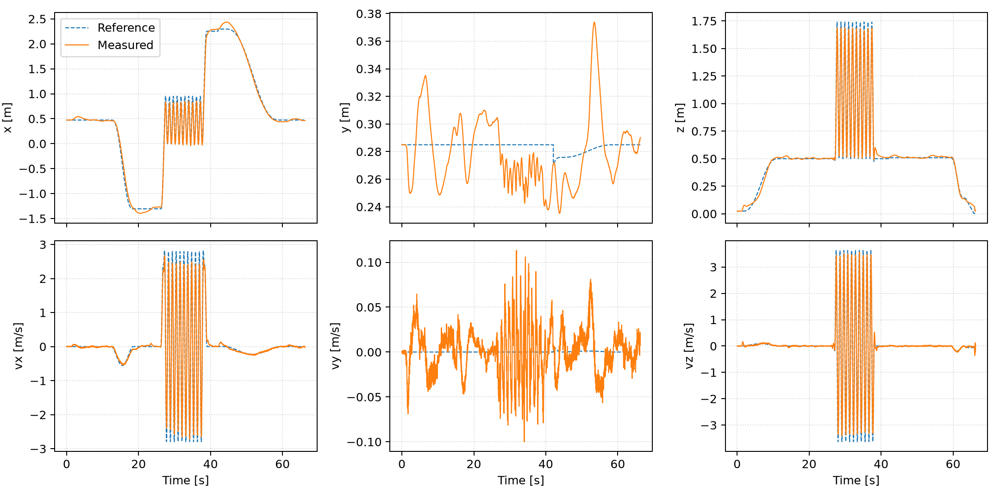
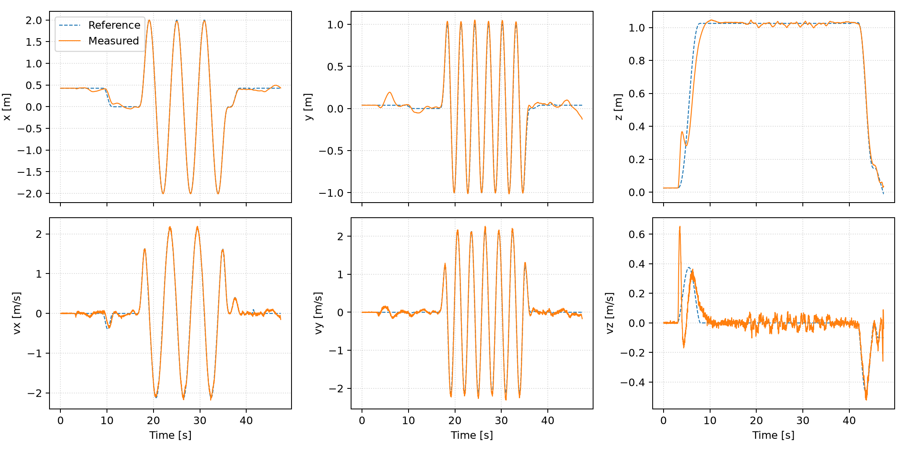

# Recorded flights and interpretation

The evidence below comes from existing recordings. Packaging this branch did not
start another physical experiment. Original run identifiers, source hashes,
configuration snapshots and outcome receipts are retained under `evidence/`.

## MPC + PID trajectory flights, 22 October 2026

All six selected runs completed five reference laps and normal PD landing. The
original assessment scores moving-reference ticks at full MPC authority, using
the same recorded root-state/reference timestamp, with no fitted time shift or
bias removal. The 3D velocity metric includes Z.

| Run suffix | Reference | XY position RMSE | 3D velocity RMSE | Mean cruise speed |
|---|---|---:|---:|---:|
| `2215e0` | Circle 1.5 m/s, R1 | 9.59 cm | 0.159 m/s | 1.380 m/s |
| `5dce40` | Lemniscate 1.5 m/s, R3.2 | 11.09 cm | 0.120 m/s | 1.449 m/s |
| `f7a876` | Circle 2.2 m/s, R1.5 | 13.72 cm | 0.228 m/s | 2.028 m/s |
| `2e3744` | Circle 3 m/s, R2 | 18.02 cm | 0.312 m/s | 2.757 m/s |
| `2c882c` | Circle 5 m/s, R2, repeat A | 25.03 cm | 0.650 m/s | 4.283 m/s |
| `b49c62` | Circle 5 m/s, R2, repeat B | 25.09 cm | 0.647 m/s | 4.281 m/s |

The 5 m/s references completed their geometric laps but undershot cruise speed;
measured peaks were about 4.526 and 4.552 m/s. Peak measured tilt was 54.46° and
53.60°. These are successful reference-following experiments, not measured 5 m/s
cruise claims. Geometry, voltage and ramp/guard settings differ between speeds.

No invalid selected MPC result or tracking fallback was recorded in those six
runs. Moving full-command p99 was about 2.44–2.52 ms; maximum was 4.886 ms with
the 25 ms deadline retained. The included [exact launch plans](../evidence/pid_launch_plans/)
show the increased 5 m/s planning/tilt limits and 4 s smoothstep ramps.

## MPC + PID pitch loops, 22 October 2026

| Full run identifier | Requested / measured inversions | Moving 3D position RMSE | 3D velocity RMSE | Outcome |
|---|---:|---:|---:|---|
| `sanity_pitch_20261022_180739_flight_c35c23` | 1 / 1 | 11.13 cm | 0.4049 m/s | Mission complete, landed |
| `sanity_pitch_20261022_180857_flight_bad56b` | 10 / 10 | 11.70 cm | 0.5626 m/s | Mission complete, landed |
| `sanity_pitch_20261022_181012_flight_8c8439` | 10 / 10 | 11.44 cm | 0.5829 m/s | Mission complete, landed |

The three receipts report no controller error or MPC rejection. The last flight
reached measured speed about 3.56 m/s and intentional near-inversion. Metrics use
causally filtered mocap; the fitted model and filtering changes were combined, so
these successes do not identify a unique causal improvement.

The included generic analyzer uses a documented reference-speed threshold of
0.001 m/s for moving samples. Its regenerated flip RMS is 11.47 cm versus the
historical report's 11.44 cm because the selection predicate differs slightly;
the two results are not silently substituted for each other.

## MPC + INDI trajectory flights, 12 November 2026

The selected R2 references use the shaped angular schedule and three laps. Recent
source/configuration changes matter: the archived successful 3 m/s flight used
35°/45° trajectory tilt thresholds; the current ordinary recipe carries the later
40°/60° tuple. Exact per-run settings are in `evidence/runs/`. These current launch
recipes reproduce the controller family and requested mission; they are not a
claim that every later guard revision was used in every archived flight.

| Recording | Outcome | Recomputed XYZ RMSE | Peak measured speed |
|---|---|---:|---:|
| R2 1.5 m/s, `07-00-29Z` | `test_complete` | See raw run receipt/configuration | Not recomputed here |
| R2 3 m/s, `07-47-59Z` | `test_complete`, disabled shutdown acknowledged | 4.21 cm | 3.135 m/s |
| R2 4 m/s, `08-23-22Z` | `test_complete`, disabled shutdown acknowledged | 5.61 cm | 4.373 m/s |
| R2 5 m/s, `08-17-48Z` and `08-24-18Z` | `hard_flight_envelope` stop | Incomplete mission | Not a completed 5 m/s result |
| R2 6 m/s | Prepared/simulated reference | No physical result included | No physical result included |

Earlier 3 m/s attempts stopped on invalid solver results or the flight envelope;
an earlier 4 m/s attempt also stopped on the envelope. Their receipts are retained,
not counted as completed flights. The successful 3 m/s run has moving full-command
p50/p99/max about 5.77/11.53/14.25 ms; the successful 4 m/s run is about
5.74/11.50/13.74 ms. These timings include more model/preparation work than the
older ideal-rate PID predictor.

The optional onboard estimator logs were not initialized/clock-valid at the final
recorded states of these sessions. Desktop mocap supplied control state, so a
completed trajectory must not be described as onboard-estimator-controlled flight.
Receiver/recording shutdown success also does not establish estimator readiness.

## Limits of the evidence

The fitted INDI response came from small upright excitations. High-rate/inverted
native INDI behavior is not qualified by moderate-angle lemniscates. The prepared
November INDI flip release had offline solver/dynamics tests and matched SZC6
receiver work; no completed physical INDI flip is included here.

The later butterfly releases, paired results and revised emergency controllers are
documented in [the latest update](latest-butterfly.md). The following paragraph
describes the archived planar controller.

High-speed emergency braking is a material unresolved limitation of these saved
controllers. At a full-speed center crossing, the retained braking reference alone
can advance about 15.0 / 23.44 / 33.75 m at 4 / 5 / 6 m/s, with long return times.
The native high-speed mission's 120 s runtime may expire before touchdown. A normal
three-lap success does not validate every interrupt/fault recovery or establish
that the room has sufficient coverage/clearance for those paths.

The original historical reports and compact receipts are included; multi-gigabyte
raw bags and private firmware images are not required to execute the code. New
recordings can be assessed with `scripts/analyze_flight.py`. Its output records the
input log hash and exact scoring predicate so results can be audited or recomputed
from the original data without fitted alignment.
