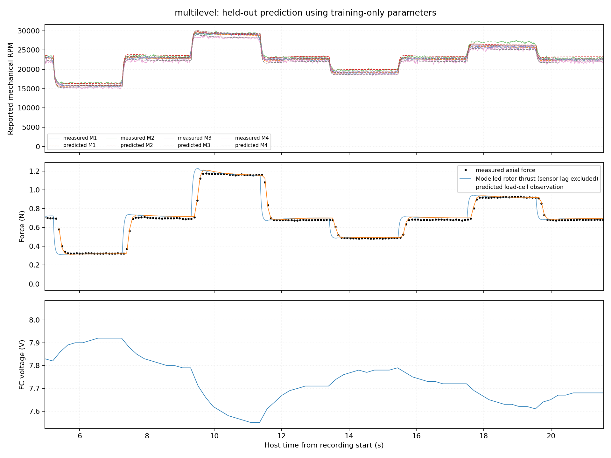
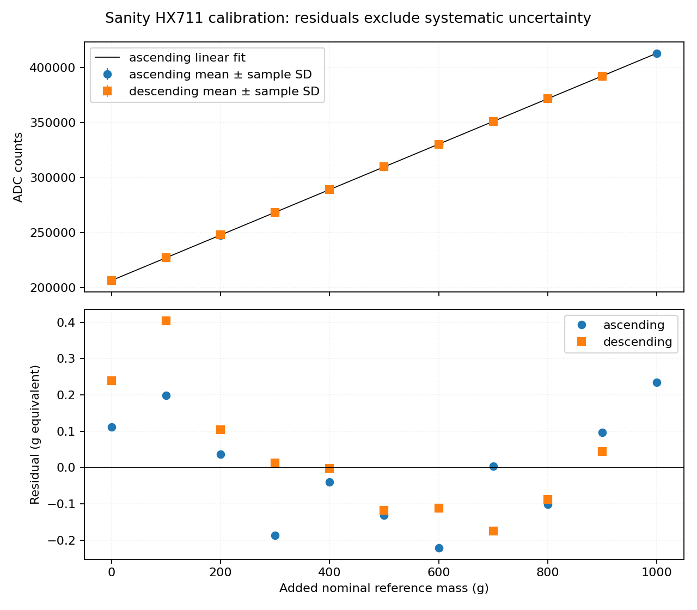

# Technical notes

## Geometry and frames

The source assembly is **Sanity_simplified v4**, exported on 2026-03-05. The URDF uses metres and radians and defines +X as forward, +Y as left and +Z as up. Its origin is the mean CAD propeller datum, confirmed by the lab as the model CoM at **[0, 0, 0] m**. Rotor positions are at $|x|=|y|=0.028461047943$ m, z ≈ 0. Registration of the physical aircraft and flight controller to this frame, including M1–M4 assignments, is not established by the supplied measurements. Rotor rotation directions are unknown; their convention is CW/CCW viewed from above, looking along −Z.

The visual model measures **111.919 × 111.919 × 29.5 mm**. It contains motors, propellers, frame, ducts and a simplified 55 × 18 × 12 mm battery. Electronics and motion-capture markers are not identifiable in the geometry. The six diffuse materials require no textures. Collision geometry is a 12-triangle enclosing box, including the duct openings.

| Source | Contents and use |
|---|---|
| DAE | COLLADA 1.4.1, metre units, Z-up; 11 instances, 66,584 triangles, six materials. Used for mesh conversion. |
| STEP | AP214, millimetres; assembly names and shaft coordinates. Used for dimensions and component identification. |
| USDZ | `Sanity.usdc`, millimetre stage, Z-up; eight mesh prototypes and 11 instances. Used for geometry cross-checks. |
| Blender | Blender 4.5 native scene; retained as an editable source. |

DAE component names are `Body1`–`Body4` for motors, `Body1.001`–`.004` for propellers, `.005` for frame, `.006` for ducts and `.007` for battery. The source hierarchy and each component's transform are written to `build/geometry/geometry.json` during conversion.

DAE transforms are composed before mesh export: top-level scale 0.001, +90° Z rotation and +0.01 m Z translation, then each mesh's scale of 10. The body transform adds [0, 0, 0.0028] m to the assembled DAE coordinates. STEP coordinates map through `Rz(+90°) × (0.001 × p_mm) + [0, 0, 0.0128]` m. Conversion places rotor geometry at the shaft coordinates above and records per-component translations. All transforms have positive determinants; coordinates are written to ten decimal places.

DAE mesh arrays and USD prototypes agree within 5.23 × 10⁻⁹ m after unit conversion; explicit USD instance translations agree with STEP. The USD reader cannot resolve reference-list operations, so these checks cover prototype geometry and explicit transforms, not full USD composition. Native STEP tessellation and Blender scene equivalence have not been checked. All four source propellers use the same handed mesh; real propeller handedness is not established by their appearance.

The paper reports an 80 mm wheelbase, 150 mm diameter, 72 g mass, BetaFPV 1102 14000 KV motors, Gemfan 45 mm three-blade propellers and a 2S 530 mAh battery. These describe the published configuration. The CAD propeller diameter is about 44.44 mm; the square CAD width and published diameter are different measurements. Current component markings and accessories remain unconfirmed.

## Mass and inertia

[models/sanity.urdf](../models/sanity.urdf) defines the mass, CoM and inertia. The geometry builder preserves its `base_link` inertial block. Bench weighings gave **39.40 g without the battery** and **66.09 g with the battery**. Each summary covers 58 samples over five seconds with 0.20 g sample standard deviation. That spread is not an absolute uncertainty estimate. Individual weighing samples and complete accessory/tare details are unavailable.

The inertia is **diag(5.75e−5, 6.64e−5, 9.31e−5) kg·m²**, estimated in-house using bifilar pendulum measurements about the aircraft CoM. The lab has confirmed this tensor and the 66.09 g mass for the contribution. No original pendulum notes exist. The supplied model uses zero cross terms.

The tensor is symmetric and positive definite. Principal-moment triangle margins are [1.02e−4, 8.42e−5, 3.08e−5] kg·m². The URDF places the tensor at **[0, 0, 0] m** with axes parallel to `base_link`. All mass and inertia belong to `base_link`; the four fixed rotor-frame links have zero mass and inertia. When loading with PyBullet, use `flags=pybullet.URDF_USE_INERTIA_FROM_FILE`. CAD densities are unsuitable for physical identification: the STEP assigns steel to the propellers and ABS to the simplified battery.

## MuJoCo XML

[models/sanity.xml](../models/sanity.xml) is a MuJoCo MJCF model, tested with MuJoCo 3.3.7. Generate it with `python tools/build_mjcf.py`; the URDF remains the source of mass, CoM, inertia, geometry and rotor transforms. The XML uses the existing OBJ meshes and diffuse colours. It has one free body and four rotor sites, with no spinning propeller joints or added component masses. Visual meshes do not collide; the enclosing collision mesh is in geom group 3. The model contains no ground plane or flight controller.

The eight inputs in `data.ctrl` are direct forces and moments:

| Frame | Thrust index (N) | Reaction-torque index (N·m) |
|---|---:|---:|
| `rotor_1_rear_right` | 0 | 4 |
| `rotor_2_front_right` | 1 | 5 |
| `rotor_3_front_left` | 2 | 6 |
| `rotor_4_rear_left` | 3 | 7 |

Positive thrust acts along the rotor's local +Z axis and should be nonnegative. Reaction torque is the signed moment **on the aircraft**, about the same axis; positive is counterclockwise viewed from above. These use MuJoCo's [site force/torque transmission](https://mujoco.readthedocs.io/en/3.3.7/XMLreference.html#actuator-general-site). Torque inputs default to zero, which omits yaw reaction torque. There is no measured torque coefficient or confirmed rotor direction with which to couple torque to thrust. No artificial saturation limits are imposed; apply the measured model's operating bounds in the calling code.

To use the fitted actuator response, advance `SpinningModel` by the simulation timestep, obtain thrusts with `SanityModel.thrusts(omega)`, and assign them to `data.ctrl[:4]` **after mapping FC outputs M1–M4 to these geometric rotor frames**. The integration supplies that mapping; it is not identified by the bench data. The XML itself takes N and N·m, not RPM or MSP counts, and does not add another motor lag. Contact parameters use MuJoCo defaults and have not been identified from hardware.

`python tools/validate_mjcf.py` checks a relocated copy, renders visual and collision geometry, and writes `build/validation/mjcf.json`. It verifies the full tensor, mesh transforms, free fall, tilted thrust axes, individual roll/pitch responses, signed torque inputs and a 0.5-second idealised force balance. These checks verify the implementation, not calibrated yaw behaviour or flight performance.

## Isaac Sim

[sanity_isaac.py](../sanity_isaac.py) implements the measured actuator in batched PyTorch tensors. It reads the existing parameter JSON and URDF; there is no separate set of fitted constants. Use the PyTorch installation supplied with Isaac Sim / Isaac Lab. The module itself has no Isaac imports and can be tested independently.

Inputs are four **MSP bench-command counts, ordered M1–M4**, and battery voltage. Commands must be within 1250–1450 and voltage within 7.5133–8.1125 V. The model updates rotor speed with the exact first-order solution, then computes thrust and the total body force and moment:

```text
T_i = k_T * omega_i**2
F_body = sum(T_i * axis_i)
M_body = sum((position_i - CoM) cross (T_i * axis_i)
             + signed_torque_to_thrust_i * T_i * axis_i)
```

The signed torque/thrust ratio has units N·m/N (metres). Positive means a reaction moment on the body about the rotor's +Z axis. Supply four ratios in M1–M4 order, or explicitly choose `omit_reaction_torque=True`. Omission gives no rotor yaw reaction moment; it is not a measured zero coefficient. The model also requires `output_to_frame`, the four URDF frame names assigned to M1–M4, without guessing the hardware mapping.

This example attaches to an already-loaded Isaac Lab robot. `frame_names_for_M1_to_M4` is supplied by the integration. The example explicitly omits yaw reaction torque:

```python
import torch
from sanity_isaac import SanityIsaacActuator, apply_to_isaaclab

motors = SanityIsaacActuator(
    num_envs=robot.num_instances,
    dt_s=physics_dt,
    device=robot.device,
    output_to_frame=frame_names_for_M1_to_M4,
    omit_reaction_torque=True,
    delay_s=0.0,
)
base_ids, _ = robot.find_bodies("^base_link$")
commands = torch.full((robot.num_instances, 4), 1350.0, device=robot.device)
motors.reset(commands, voltage_V=7.8)

# Once per physics step, including every substep between policy updates:
output = motors.step(commands, voltage_V=7.8)
apply_to_isaaclab(robot, output, body_ids=base_ids)
robot.write_data_to_sim()
sim.step()
robot.update(physics_dt)

# During a partial episode reset, clear only those motor states and commands:
motors.reset([1350.0] * 4, voltage_V=7.8, env_ids=reset_env_ids)
```

`apply_to_isaaclab` uses the current `permanent_wrench_composer.set_forces_and_torques` API when available, otherwise `set_external_force_and_torque`. Both receive local-frame force and torque tensors of shape `(num_envs, 1, 3)` for the single base body. The adapter supplies the total moment about the CoM, so do not apply the same rotor lever-arm moments again. Physics outputs must use float32. The [Isaac Lab force API](https://isaac-sim.github.io/IsaacLab/v2.3.0/source/api/lab/isaaclab.assets.html#isaaclab.assets.Articulation.set_external_force_and_torque) requires `write_data_to_sim()` before stepping; the newer [wrench composer](https://github.com/isaac-sim/IsaacLab/blob/main/source/isaaclab/isaaclab/utils/wrench_composer.py) follows the same buffered workflow.

Import the URDF as a free base with its supplied inertia, merging the fixed rotor-frame links into the rigid body. The resulting USD has one rigid body and no articulation: load it with **`RigidObject` / `RigidObjectCfg`**, not `Articulation`. Preserve `base_link` axes and CoM. The adapter reads rotor positions from the URDF even when those links are merged. No propeller joint drives are needed. The XML supplied here is the MuJoCo target; it does not install this Python actuator in Isaac Sim.

The aircraft retains all six rigid-body degrees of freedom. Rotor speed is a state in the actuator model, and rotor forces and moments act on the body. Isaac Lab's [reference Crazyflie configuration](https://github.com/isaac-sim/IsaacLab/blob/v2.3.0/source/isaaclab_assets/isaaclab_assets/robots/quadcopter.py) includes spinning rotor joints, but its [flight task](https://github.com/isaac-sim/IsaacLab/blob/v2.3.0/source/isaaclab_tasks/isaaclab_tasks/direct/quadcopter/quadcopter_env.py) also applies thrust and moments directly to the main body. Sanity omits rotor animation and separate rotor angular-momentum dynamics.

Delay defaults to zero because the measured 19.29 ms includes USB and telemetry. To reproduce the bench response, pass `delay_s=SanityModel().L` from `sanity_actuator`. Fractional delays are split within each fixed physics step. Returned thrusts use the endpoint rotor speeds. Reset initializes already-spinning motors; startup, arming, stopping and a flight controller are not modelled. Call `motors.reset(...)` together with the robot reset, then refresh the wrench before the next physics step. Do not add a second motor lag in the simulator.

The policy's action scaling belongs to the integration: this module does not define γ₀ actions. `wrench_from_speeds(omega_rad_s)` also exposes the static force calculation when speed dynamics are handled elsewhere. In an implementation using revolutions/s, the equivalent square-law coefficient is **1.238019669e−6 N/(rev/s)²**. `validate_inputs=False` avoids GPU synchronisation for range checks once the caller enforces input bounds and initialization.

Eight offline tests cover scalar-model agreement with changing commands/voltage and fractional delay, closed-form response, partial resets, hover-force balance and moment signs, rotated rotor axes/CoM offsets, input limits, force-API argument contracts, and a 4,096-environment CPU/CUDA comparison. These pass with PyTorch 2.11.0 / CUDA 13.0. Run `python -m unittest discover -s tests -p test_sanity_isaac.py -v`. PyTorch is optional for the rest of the repository, so these tests report skips when it is unavailable.

### Native Isaac validation

[tools/validate_isaac.py](../tools/validate_isaac.py) runs the imported robot through the real Isaac Lab force API and PhysX. Tested on **Isaac Sim 5.1.0, Isaac Lab 2.3.2.post1, PyTorch 2.7.0+cu128 and Warp 1.13.0**, on an RTX 5090. The test uses eight GPU environments and a 1 ms physics timestep.

| Check | Result |
|---|---|
| Portable import | Converts a temporary copy of the URDF/meshes, relocates the generated USD, then loads it after deleting the temporary source |
| Geometry and materials | Six visual meshes, one collision mesh and six materials; vertex error ≤ 2.63 × 10⁻⁹ m; dimensions 111.919 × 111.919 × 29.5 mm |
| Physical properties in PhysX | Mass, CoM and full inertia match the URDF within float32 precision |
| Free fall | 0.2 s drop agrees with gravity and the discrete timestep; velocity error < 2.3 × 10⁻⁶ m/s |
| Ideal hover | Equal rotor forces balance gravity for 0.5 s; zero reported position drift |
| Force and moment directions | Each rotor's roll/pitch response and 30° tilted body-local thrust pass; signed yaw inputs pass using an explicitly synthetic coefficient |
| Actuator dynamics | 1250 → 1450 → 1250 counts, changing voltage and the fitted delay; rotor speeds agree with the scalar model within 0.0015 rad/s, and native velocity increments agree with applied forces within 3.0 × 10⁻⁸ m/s |
| Resets | Partial environment resets and removal of buffered forces with a zero wrench pass |
| Rendering | Native 960 × 720 render inspected; geometry, orientation and rotor placement agree with the source |

Run from the repository root using an Isaac Sim / Isaac Lab Python environment:

```sh
python tools/validate_isaac.py
```

The script writes `report.json`, `render.png`, `step_response.csv` and the imported USD to `build/validation/isaac/`. It uses `fix_base=False`, `merge_fixed_joints=True`, `joint_drive=None`, metre units and explicit inertia-tensor import. The tested Isaac Lab converter selects URDF importer 2.4.31 to preserve fixed-link merging. The native force path exercised is `permanent_wrench_composer`; the older API fallback has offline contract tests only.

To load the generated USD in an existing Isaac Lab scene:

```python
import isaaclab.sim as sim_utils
from isaaclab.assets import RigidObject, RigidObjectCfg

robot = RigidObject(RigidObjectCfg(
    prim_path="/World/Sanity",
    spawn=sim_utils.UsdFileCfg(usd_path="/absolute/path/to/build/validation/isaac/usd/sanity.usd"),
    init_state=RigidObjectCfg.InitialStateCfg(pos=(0.0, 0.0, 1.0)),
))
sim.reset()
```

These are implementation checks with a synthetic output-to-frame assignment, no aerodynamic drag and no flight controller. They do not establish the hardware rotor mapping, reaction-torque coefficient, contact behaviour or sim-to-real policy performance.

## Actuator equations

[actuators.json](../parameters/actuators.json) contains the parameters needed to use the model. Fit diagnostics, candidate comparisons and uncertainty estimates are in [fit_report.json](../data/processed/actuator/fit_report.json). [sanity_actuator.py](../sanity_actuator.py) evaluates the model without accessing hardware. Rotor order is FC outputs M1–M4.

The static model is `T_i = 3.135940456614356e-8 * omega_i**2` N. Collective force is the sum of individual rotor forces. It fits 41 later settled phases and ten earlier sweep levels, with **0.01754 N RMS error** and **R² = 0.99930**. The plot in the main README shows only collective measurements; the fit also uses individual tests.

For already-spinning motors:

```text
q = (u - 1350) / 100
omega_ss_i = (V / 8) * (a_i + b_i*q + c_i*q*q)
domega_i/dt = (omega_ss_i(u_i(t-L), V(t)) - omega_i) / tau
L = 0.01928848119734354 s
tau = 0.03741163154618727 s
```

| FC output | a (rad/s) | b (rad/s) | c (rad/s) |
|---|---:|---:|---:|
| M1 | 2452.314683 | 773.184878 | −20.656932 |
| M2 | 2532.059942 | 749.615960 | −49.751318 |
| M3 | 2472.331335 | 784.478073 | −14.465018 |
| M4 | 2393.745347 | 750.997674 | −20.654472 |

The command map covers **1250–1450 external MSP counts** and observed plateau voltages **7.5133–8.1125 V**. Voltage is an input; battery evolution is not modelled. These bounds describe the observations, not a complete grid of every voltage/command combination. Startup, stopping, yaw reaction torque and flight-controller stabilization are outside this model.

Betaflight reports mechanical RPM using its configured 12 poles. Angular speed is `RPM × 2π/60`. If the physical motor has P poles, true speed is reported speed × 12/P and the thrust coefficient scales by (P/12)². Physical pole count remains unconfirmed.

The fitting report also records a local-range comparison using `T_i = max(3.2732551603912513e-8 * omega_i**2 - 0.009962661170831744, 0)`. It improves the force fit over the later tests' range; its offset is not a measured command deadband. The exported model uses the one-coefficient square law above.

### Response and prediction checks


The plot combines 56 increasing and 48 decreasing rotor-speed traces. Each trace is normalised using its measured settled endpoints (0 = low speed, 1 = high speed); time zero is the host command send. This compares response shape rather than absolute command-to-speed prediction. Generate both README figures with `python tools/plot_actuators.py`.

Model selection compared static force laws, rising/falling responses and command maps. It chose the simplest form within 5% of the best reserved-cycle RMS error. Last repeated cycles selected complexity; multilevel and reference runs were held out for prediction checks. The selected models were then refitted to all applicable runs.



Training-only multilevel/reference RMS errors were **317/426 RPM** and **0.01609/0.02546 N** observed force. The force predictions use that local-range fit, recorded voltage, one initial measured speed and a separate sensor response model. Those force errors are not scores for the compact full-range law. The final refitted coefficients have no untouched test set remaining.

The 19.29 ms apparent delay includes USB, FC, ESC and telemetry effects. Using request/reply midpoint timing gives 10.94 ms. Conditional bootstrap intervals are 16.99–21.69 ms for delay and 34.40–39.97 ms for the time constant; systematic calibration, fixture, pole-count and telemetry-age uncertainties are excluded.

The separate load-cell observation delay (~123 ms) and time constant (~51 ms) describe the sensor and fixture. **Do not apply this filter to simulated aerodynamic thrust.**

## Calibration

See the [data guide](../data/README.md) for run roles and file columns. The load cell was calibrated with nominal 100 g increments from 0 to 1000 g and back, 40 samples per level: **840 samples across 21 levels**. Ascending means determine the slope; descending points assess hysteresis.



The slope is **21036.44535 counts/N**, using g = 9.80665 m/s². Ascending fit residual RMS is 0.14454 g equivalent. The measured force range is 0–9.80665 N in the tested direction. Reference-weight accuracy and load-cell capacity are unconfirmed. Mounted 100 g checks differed by −0.25% to −0.41%; off-axis accuracy was declared by the operator but not quantified.

The aircraft was mounted on the load cell. Collective tests commanded all four motors; individual tests commanded one output at a time. Thrust is the axial load change from each run's stopped baseline. Positive thrust follows increasing measured load. These measurements include ducts, stand and airflow effects. Collective thrust divided by four is an equal-share estimate, not an independently measured rotor curve.

The earlier sweep reached 2000 counts but stopped after severe battery sag. Its final ten samples average **3.2424 N collective thrust** at about 5.69 V. This is an observed, battery-critical result rather than a usable maximum. Later powered runs stayed within the smaller fitted command range. Earlier sequential step logs are excluded from fast-response fitting because their timing couples force reads and RPM requests.

Current, voltage and mechanical RPM come from the FC; force comes from the HX711. FC meter calibration is unverified. Each channel has separate timestamps. Later powered tests achieved **47.4–48.0 RPM replies/s** and **11.46 force samples/s**, with battery/status requests every 0.2 s. The user identified the computer as an Orin Nano Developer Kit; reader metadata reports an Orin NX module on P3768.

## Hardware control

The inspected Sanity flight code is in the `sanity_network` workspace. A policy can replace the offboard LQG publisher with `freyja_msgs/msg/CtrlCommand` on `/sanityNN/ctrl_command`:

| Field | Meaning | Units / sender limits |
|---|---|---|
| `roll` | Roll angle | rad, ±π/6 |
| `pitch` | Pitch angle | rad, ±π/6; negated before channel mapping |
| `yaw` | Yaw rate | rad/s, ±10.471976 (600°/s) |
| `thrust` | Collective aircraft thrust | N; physical valid range unconfirmed |

The broadcaster maps channels to 1000–2000. Its existing thrust converter is `T=0 → 1000`, otherwise `int(clip(-26.92*T*T + 296.3*T + 1162, 1000, 2000))`. The original measurements behind this converter are unavailable. The new USB motor-test curve does not recalibrate the attitude/collective flight path.

Transport is ROS 2 → UDP → ESP32-S3 → SBUS → Betaflight. UDP uses port 10240, stream 777, a 25-byte header, nine-byte device records and a trailing zero byte. Each record is big-endian `flags:uint8, roll:uint16, pitch:uint16, yaw:uint16, thrust:uint16`. Device n uses slot n+1; slots 0 and 1 are reserved. The sender supports IDs 1–222. ESP32 SBUS uses inverted UART at 100000 baud, 8E2, channel order roll/pitch/thrust/yaw, mapping 1000–2000 to 192–1793.

Betaflight ANGLE mode stabilizes roll/pitch attitude and yaw rate with its IMU and mixer. Position/velocity control runs offboard. Inspected defaults are 50 Hz LQG, 100 Hz TF polling, 10 Hz estimator configuration, and 100 Hz UDP/SBUS. The launch file comments out the broadcaster; it needs to be started separately. Actual deployed rates, flight mode, PID/filter settings and network latency are unverified. The paper's 50 Hz SBUS and ±60° attitude settings differ from these source settings.

Sender startup arms configured IDs at minimum thrust. Fresh valid commands set arm flag 1; stale or invalid commands disarm after the default one-second timeout. Receiver startup is disarmed; timeout or Wi-Fi loss disarms. Fresh commands can rearm at the requested thrust without a mandatory minimum-thrust sequence. Shutdown sends disarm packets over UDP, whose delivery is not guaranteed.

### Observations

Motion capture enters through TF with the aircraft name as robot frame and `map` as base frame. The Sanity Freyja checkout is empty; a related populated checkout provides this candidate `CurrentState` ordering:

```text
pn, pe, pd, vn, ve, vd, roll, pitch, yaw, rrate, prate, yrate, delta_t
```

Declared units are m, m/s, rad, rad/s and s, plus a header and validity flag. Related source maps TF [x,y,z] to [y,x,−z], filters position/velocity and changes yaw to π/2−yaw. This conversion needs to be checked against the deployed code and known aircraft orientations. Entries 9–11 in that branch come from position-filter states; their meaning as angular rates is unverified. The UDP/SBUS bridge exposes no direct FC IMU/gyro observations. TF polling frequency does not establish observation freshness.

### USB bench commands

The [FC profile](../data/provenance/fc_profile.json) records Betaflight 4.5.1, MSP API 1.46, BETAFPVF405/STM32F405, four outputs, DSHOT300, bidirectional telemetry, 12 configured poles and 3D mode disabled. The board label is F405 2–3S 20A V1.0; exact ESC firmware and installed motor/propeller/battery models remain unconfirmed.

`MSP_SET_MOTOR` (214) controls M1–M4 while disarmed, bypassing attitude stabilization. Commands are digital motor-test counts: **1000 stops**, 2000 is the interface endpoint. They are not raw DShot values or PWM pulse widths. Deadband, saturation and usable thrust limits are unknown. Cleanup sends stop and waits for an ACK; an ACK confirms receipt, not physical stop. There is no independently established watchdog for host/USB failure. Collection procedures and shutdown handling are in [tools/acquisition/README.txt](../tools/acquisition/README.txt).

A flight policy using attitude/collective actions needs a matching inner controller and mixer in simulation. A policy producing individual rotor forces needs adaptation or a separately validated motor-level flight interface. USB bench control is not that flight interface.

## Validation

| Check | Result |
|---|---|
| Geometry | 66,584 visual triangles; positive transform determinants; triangle/normal serialization checks; collision envelope contains all vertices |
| URDF import | PyBullet 3.2.7 loads a free base, four massless fixed rotor frames and six visual shapes; total mass, CoM and inertia match the URDF |
| MuJoCo XML | MuJoCo 3.3.7 loads relocated assets; compiled vertices agree within 3.44 × 10⁻⁹ m, materials and rotor sites match, and mass/CoM/inertia match the URDF |
| Physical parameters | The confirmed inertia passes symmetry, positive-definiteness and triangle checks; total mass is 0.06609 kg |
| Calibration and fitting | Load-cell scale reproduces; four fitted coefficient vectors and held-out metrics reproduce from the included data |
| Offline evaluator | Four tests: delayed step, timestep consistency, domain rejection and summed rotor forces |
| Isaac adapter | Eight offline tests plus native Isaac Sim 5.1.0 / Isaac Lab 2.3.2 checks: portable import/render, physical properties, free fall, hover, force/moment signs, actuator steps and partial resets in eight GPU environments |
| Native force checks | Four equal +Z forces balance the 0.6481215 N weight for 0.5 s; a separate force at each rotor produces the expected roll/pitch acceleration |
| MuJoCo force checks | Free fall, 0.5 s balanced thrust with zero drift, individual roll/pitch moments, body-relative thrust under tilt, and positive/negative reaction-torque inputs pass |
| Actuator force balance | Equal rotor speed 2273.08 rad/s gives total thrust equal to the aircraft weight |
| Scalar dynamics | Two-second vertical pulse check with fixed attitude and voltage; finite response and return to force balance |
| Hardware evidence | Five later powered bench runs completed without invalid force samples or battery warnings; flight-policy validation remains unperformed |

The PyBullet force checks omit reaction torque; MuJoCo checks the signs of explicit torque inputs without identifying a physical torque coefficient. Neither models the flight controller. The scalar check holds attitude fixed and excludes yaw, drag and battery dynamics. No complete aircraft dynamics or sim-to-real validation is claimed. The flight videos show separate research demonstrations.

Run the commands in the main README to regenerate the reports under `build/geometry/` and `build/validation/`. Repository validation also checks source/data hashes, documentation links, PDF and media files. Scientific plots use Matplotlib. To rebuild video previews from the original large media files, run `python tools/build_media.py --source-dir /path/to/figures`; this needs FFmpeg and Poppler. Source filenames and conversion settings are in [the media script](../tools/build_media.py).
